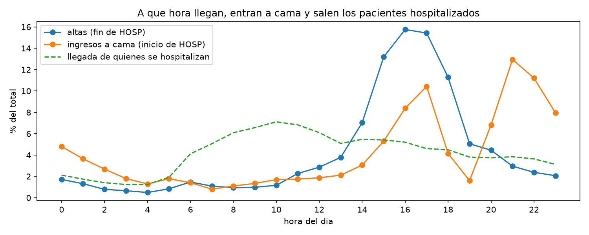
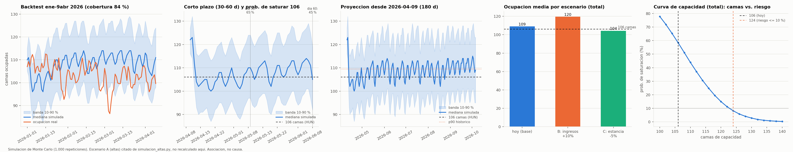

# ¿Por qué se espera tanto por una cama?
## Flujo de pacientes, cuellos de botella y anticipación en el Hospital Universidad del Norte

**Data Challenge HUN 2026** · Hospital Universidad del Norte (HUN) y pregrado de Ciencia de Datos, Universidad del Norte
**Equipo:** Daniela (coordinación, datos y análisis), Samuel (estimador de tiempos, recomendaciones y dashboard), Anthony (modelo explicativo y simulación de camas)
**Versión:** borrador del 12-nov-2026 (con la estacionalidad anual del pronóstico, ficha A9) · **Entregables:** este documento, el repositorio en GitHub y el dashboard interactivo

> **Cómo leer este documento.** Cada cifra lleva al lado el documento del repositorio donde se calcula y el script que la produce. Casi todo
> son **asociaciones y escenarios**, no causas probadas, y cada hallazgo lleva su limitación junto a él. Los datos clínicos no están en el
> repositorio: solo el código, las consultas, los documentos y los gráficos.

---

## Índice
1. [Resumen ejecutivo](#1-resumen-ejecutivo)
2. [El reto y qué abordamos](#2-el-reto-y-qué-abordamos)
3. [Los datos y su calidad](#3-los-datos-y-su-calidad)
4. [Cómo fluye el paciente (componente 1)](#4-cómo-fluye-el-paciente-componente-1)
5. [El cuello de botella y sus factores (componente 2)](#5-el-cuello-de-botella-y-sus-factores-componente-2)
6. [Modelos, predicción y simulación (componente 3)](#6-modelos-predicción-y-simulación-componente-3)
7. [Recomendaciones (componente 4)](#7-recomendaciones-componente-4)
8. [El dashboard](#8-el-dashboard)
9. [Limitaciones](#9-limitaciones)
10. [Trabajo en curso y futuro](#10-trabajo-en-curso-y-futuro)
11. [Anexos: glosario, reproducibilidad y mapa del repositorio](#11-anexos)

---

## 1. Resumen ejecutivo

**La pregunta del reto:** comprender, predecir y optimizar el flujo de pacientes del hospital, identificando cuellos de botella, patrones
operacionales y oportunidades de mejora en los tiempos de atención. Abordamos los cuatro componentes del instructivo.

**Lo que encontramos, en ocho puntos:**

1. **El cuello de botella es la espera de cama.** Desde que el paciente llega hasta que se le asigna cama pasan, en mediana, **18,6 horas**;
   uno de cada diez espera más de **73,9 horas** y el 43,7 % espera más de un día. El 98 % de ese tiempo transcurre en urgencias antes de
   que se asigne la cama.
2. **Los peores casos empeoran.** La espera mediana casi no cambió entre 2023 y 2026 (17–20 h), pero el percentil 90 pasó de 61 a 81 horas y
   el exceso medio de espera por paciente creció 38 %.
3. **La cama llega en dos olas, por la tarde y por la noche.** El 61 % de las camas se asigna entre las 15 y las 17 h o entre las 20 y las 23 h;
   solo el 9 % en la mañana. El 63 % de las altas sale entre las 14 y las 19 h. Quien llega a media mañana espera hasta la tarde.
4. **Hay un límite de proceso, no solo de camas.** Una cama que se libera en la mañana tarda una mediana de 1,8 horas en volver a asignarse,
   aunque siempre haya unos 26 pacientes esperando.
5. **La ocupación sube porque los pacientes se quedan más, no porque lleguen más.** Las camas ocupadas pasaron de 94 (2023) a 105 (2025),
   frente a 106 camas del hospital; los ingresos se mantienen en ~20 por día y la estancia media subió 16 % (4,6 a 5,3 días).
6. **Se puede anticipar el día y el año:** las llegadas se pronostican con ~8 % de error a una semana y ~10 % a un año, ahora con la forma del
   año (más pacientes a mitad de año, menos en diciembre); una alerta a mediodía detecta 13 de cada 15 días
   congestionados; la cola de pacientes sin cama se pronostica a 6–12 h con un tercio menos de error que suponer que todo sigue igual.
7. **La simulación de camas muestra que la estancia es la palanca más barata:** bajar la estancia 5 % reduce los días saturados casi tanto como
   los aumentaría un 10 % más de ingresos.
8. **Estimar la espera de cada paciente choca con lo que la base no registra.** El estimador construido mejora el rango ~9 % y acierta sus
   percentiles, pero su error típico sigue en ~24 h. Si el hospital registrara la **gravedad (triage) y el servicio** al llegar, la mejora se
   duplicaría (de 8,4 % a 16,9 %).

**Lo que proponemos:** registrar mejor (salida de urgencias, asignación de cama, triage, servicio y hora de la orden de hospitalización), una
reunión diaria de camas apoyada en alertas, adelantar las altas **y** asignar enseguida la cama que se libera, una alerta por paciente sin cama
con responsable, y revisar cada semana las estancias largas (sección 7).

---

## 2. El reto y qué abordamos

**Contexto.** El instructivo pide abordar uno o varios de cuatro componentes y valora los hallazgos estratégicos para el hospital, la
interpretabilidad, la visualización efectiva y la comunicación clara que traduzca los análisis en acciones. Los entregables son la
documentación, el repositorio en GitHub y el enlace a un dashboard interactivo (los organizadores aceptaron Dash en lugar de Power BI).

| Componente del instructivo | Qué hicimos | Dónde |
|---|---|---|
| 1. Caracterizar el flujo reconstruyendo las etapas | Limpieza de la base, episodios, rutas, tiempos por etapa | Sección 4; `docs/HALLAZGOS.md` 2–3 |
| 2. Factores de los tiempos y la estancia; cuellos de botella | Definición formal de cuello de botella, ranking, carga, altas tardías, perfiles, diagnósticos, estancias largas, etapas de urgencias | Sección 5 |
| 3. Modelos para estimar tiempos, saturación y patrones atípicos | Pronóstico de demanda, alertas, días atípicos, estimador de espera por paciente, simulación Monte Carlo de camas, pronóstico de la cola | Sección 6 |
| 4. Propuestas accionables | Siete recomendaciones con su cifra, su evidencia externa verificada y su límite | Sección 7 |

**Decisión de enfoque:** la profundidad va en la espera de cama (componente 2) y en los modelos (componente 3); el componente 1 da el contexto y
el 4 sale de los dos anteriores.

---

## 3. Los datos y su calidad

### 3.1 La base
Base PostgreSQL en el esquema estándar **OMOP** (`uninorte_omop`), de solo lectura y detrás de VPN. Tablas: `visit_occurrence` (1,7 millones de
visitas), `visit_detail` (3,28 millones de etapas), `person` (912 mil personas), `condition_occurrence` (38,6 millones de filas de
diagnósticos), `procedure_occurrence` (47 millones) y `measurement` (16,6 millones de laboratorios). Periodo: enero de 2023 a julio de 2026.

Lo que la base **no** trae, aunque el instructivo lo mencione: servicio, piso o cama; triage; hora de la orden de hospitalización; hora de los
procedimientos (la columna está vacía en toda la tabla); diagnóstico principal; signos vitales; y la duración de la visita (inicio = fin en el
100 %). Las duraciones salen de las **etapas** (`visit_detail`), que son de cuatro tipos:

| Código | Lo llamamos | Qué parece ser |
|---|---|---|
| 9203 | Llegada (ER) | Admisión o triage en urgencias; dura minutos |
| 3045729 | Urgencias (TU) | Atención en urgencias, incluida la observación y la espera |
| 9201 | Cama (HOSP) | Hospitalización; según el HUN, se registra **al asignar la cama** |
| 581479 | Ambulatorio (AMB) | Evento administrativo de duración cero; se descarta |

### 3.2 Problemas encontrados y cómo se resolvieron

| Problema | Tamaño | Qué se hizo |
|---|---|---|
| Visitas copia (mismo contenido con otro id) | ~30 % de las visitas | Se borran las de la misma persona y su información pasa a la visita original |
| **Estancias en cama duplicadas en dos personas** | 41 % de los hospitalizados | Cada estancia se cuenta una vez (regla v3.8: 25.777 estancias únicas) y se conserva la **persona real**, identificada por quién domina los diagnósticos y laboratorios en el 97,6 % de los casos |
| Etapas de urgencias sin hora de salida | 36–42 % | Se marcan sin duración (no como 0 h); la duración de urgencias de quien se va de alta solo se describe, con métodos de supervivencia |
| Etapas abiertas al momento de la extracción | 2.053 | Se descartan |
| **Registro de etapas degradado desde el 10-abr-2026** | La etapa de llegada cae de 65 % a 30 % de las visitas mientras las visitas no bajan | Se usa solo el **periodo confiable: 1-feb-2023 a 9-abr-2026** |
| Caída de todo el registro el 28 y 29 de marzo de 2026 | 14 y 118 visitas (lo normal: 400–600) | Se excluyen |

**Por qué importa:** sin esta limpieza el hospital parecía tener ~146 camas ocupadas y 27,7 ingresos por día; los valores reales son ~100 camas y
~20 ingresos. La auditoría directa en la base (2-nov) y la reproducción del pipeline en un clon limpio confirmaron las cifras.
Detalle: `CLAUDE.md` 4.1–4.13; `docs/HALLAZGOS.md` 2; `src/analisis_etapas.py`, `src/preparar_variables.py`, `src/auditoria_bd.py`.

**Resultado:** 337.194 episodios (atención continua de un paciente; se corta tras 168 h sin etapas). En el periodo confiable, 22.819 estancias
únicas con espera de cama medida.

### 3.3 Lo que dijo el hospital (sesión del 29-oct-2026)
106 camas de hospitalización (88 de adultos y 18 de niños) y 58 camillas de urgencias; la hospitalización se registra al asignar la cama; las
estancias en dos personas «probablemente son duplicados»; hay horarios y costumbres de alta. No dieron la meta de tiempos ni la causa del cambio
de registro de abril de 2026. No hubo más sesiones.

---

## 4. Cómo fluye el paciente (componente 1)

- **Llegadas:** ~265 episodios por día. Pico entre las 9 y las 11 h, mínimo de 3 a 4 h; el lunes es el día más cargado y el fin de semana llega
  ~30 % menos. Incluyen ~4 % de réplicas de registro, estables en el tiempo (no se deduplican).
- **Recorrido:** llegada (minutos) → urgencias → cama. Solo ~1 de cada 8–10 atendidos se hospitaliza (~20 ingresos a cama por día).
- **Urgencias sin hospitalizar:** con supervivencia (Kaplan-Meier) la mediana es de ~11 h y el percentil 90 de 71–81 h; quedarse solo con los
  que tienen hora de salida la subestima (`docs/supervivencia_urgencias.md`).
- **Estancia en cama:** mediana de 71 h, percentil 90 de 280 h, media de 5,2 días.
- **Entre etapas casi no hay tiempo muerto:** el «hueco sin registro» antes de la cama que se creía del 21 % resultó un artefacto de las estancias
  duplicadas; en el registro de la persona real es ~1 % de las horas (`CLAUDE.md` 4.12).
- **Reingresos depurados:** 5,3 % en 72 h y 14,1 % en 30 días (`docs/c4_reingresos_huecos_llegadas.md`).

---

## 5. El cuello de botella y sus factores (componente 2)

### 5.1 Definición
Un segmento del recorrido es **cuello de botella** si (1) es una espera y no atención clínica, (2) tiene exceso sobre una referencia de «cuando
el hospital funciona bien» (la mediana con carga baja), (3) tiene impacto alto (volumen × retraso) y (4) se agrava con la carga. El orden de los
resultados no cambia con cuatro referencias distintas ni con tres cortes de episodio (`docs/plan_de_accion.md`; `src/ranking_cuellos.py`).

### 5.2 La espera de cama es el cuello de botella

| Segmento (estancias únicas) | n | Mediana | p75 | p90 |
|---|---|---|---|---|
| **Espera de cama** | 25.373 | **18,6 h** | 37,9 h | **73,9 h** |
| Urgencias antes de la cama | 25.373 | 11,1 h | 29,5 h | 55,9 h |
| Estancia en cama | 25.777 | 70,7 h | 143,9 h | 280,3 h |

- El **64 %** de las horas de espera (518 mil de 812 mil horas-paciente) está por encima de la referencia de carga baja.
- El 83 % de las horas de espera viene de esperas de más de 24 h, y el 57 % de esperas de más de 48 h (el 19 % de los pacientes).

### 5.3 Los peores casos empeoran

| Año | Mediana | p90 | Exceso medio por paciente |
|---|---|---|---|
| 2023 | 19,5 h | 61,6 h | 17,3 h |
| 2024 | 18,3 h | 69,7 h | 18,6 h |
| 2025 | 17,4 h | 80,2 h | 23,8 h |
| 2026 (ene–9 abr) | 19,8 h | 81,9 h | 23,8 h |

### 5.4 La hora del día manda más que el número de camas
- **Altas tardías (hipótesis sostenida en 4 de 4 criterios):** el 62,7 % de las altas ocurre entre las 14:00 y las 18:59 y solo el 14 % antes del
  mediodía. Quien llega a las 8 h recibe cama al día siguiente en el 50 % de los casos; a las 16 h, en el 72 %.
- **La cama llega en dos olas:** 23,8 % entre las 15 y las 17 h y 37,5 % entre las 20 y las 23 h (61 % juntas); 8,9 % entre las 6 y las 11 h.
  Parte de la ola nocturna podría ser la hora en que se digita en el sistema.
- **Límite de proceso:** una cama liberada entre las 6 y las 12 h tarda una mediana de 1,8 h en volver a asignarse (un tercio tarda más de 3 h),
  aunque haya ~26 pacientes esperando; las de la tarde tardan 0,4 h (`docs/saturacion_y_espera.md` 3).
- **El orden de llegada casi no predice el orden de cama** (53 % de pares en orden; el azar daría 50 %): no hay una fila única.

### 5.5 La saturación mueve la cola larga, no la espera típica
- El hospital está saturado casi siempre: en adultos nunca hay una hora sin pacientes esperando cama y el 75 % de las horas tiene el 90 % o más de
  las camas ocupadas.
- Cada 10 camas ocupadas más al llegar suben la espera ~7 % (adultos +7,2 %, IC 95 % +3,5 a +11,1); la **mediana casi no cambia** (18,7 h con
  ≤ 90 camas, 19,8 h con más de 115) pero el **p90 pasa de 60 a 80 h** (`docs/saturacion_y_espera.md`).
- La cola de pacientes esperando cama (media de 26) no depende de la ocupación: no se puede estimar un «techo» de camas desde los datos
  (`docs/capacidad_efectiva.md`).
- **La ocupación sube por la estancia:** 94 → 101 → 105 camas (2023–2025) con ingresos estables (20,6 → 19,8 por día) y estancia media de 4,57 a
  5,31 días. Con la ley de Little, volver a la estancia de 2023 liberaría ~15 camas. El exceso sobre las 106 camas está en **adultos** (101 % de
  sus 88 camas en 2025) y viene de estancias largas con actividad clínica diaria, no de camas «fantasma» (`docs/ocupacion_por_zona.md`,
  `docs/dias_cama_baja_actividad.md`). Pasar de 106 puede ser sobreocupación o una capacidad real mayor; los datos no lo distinguen.

### 5.6 Dónde se va el tiempo dentro de urgencias
- Cada estancia tiene en promedio 2,5 etapas de urgencias seguidas. **El tiempo extra de las esperas largas está en la última etapa antes de la
  cama:** 53 % de la espera en quienes esperan menos de 6 h, 63 % entre 12 y 48 h y **78 %** en quienes esperan más de 72 h (mediana de 69 h).
- En esa última etapa hay ~1 laboratorio cada 10 h y casi ningún diagnóstico nuevo: es compatible con un paciente ya decidido que espera cama.
  **Hipótesis:** la base no dice qué es cada etapa (`docs/caracterizacion_etapas_tu.md`, `docs/etapas_tu_por_examen.md`).

### 5.7 Qué factores se asocian a la espera y a la estancia

**Espera de cama** (modelo sobre el logaritmo, R² = 16 %: el 84 % de la variación no se explica con lo observado; `docs/HALLAZGOS.md` 4.5):
diagnóstico 7,2 puntos de R², edad y sexo 4,1, tipo de visita 2,0, hora de llegada 0,6, carga y año 0,1 cada uno, calendario ~0.

**Modelo explicativo de A4** (regresión logística sobre «esperar más de 24 h», validada en tres tramos temporales; `docs/modelo_espera.md`):
AUC de 0,68 en la prueba de 2026. Esperan más los de 30 a 59 años (OR 1,6–1,8 frente a 15–29), las **mujeres (OR 1,37)** y quienes llegan con
más carga reciente (OR 1,25 por desviación); esperan menos los niños de 0 a 4 años (OR 0,40) y las visitas ambulatorias (OR 0,16). Para alertar
a un paciente concreto no sirve: marcaría al 44 % de los pacientes con 4 de cada 10 falsas alarmas.

**Quién es el paciente** (`docs/que_esperar_segun_paciente.md`, `docs/perfiles_pacientes.md`):

| Característica | Espera de cama (mediana) | Estancia en cama (mediana) |
|---|---|---|
| Edad | Niños 0–4: 7,8 h; 5–14: 12,3 h; 15–29: 17,2 h; desde 30: 24–27 h | Sube con la edad: 52–68 h hasta los 44; 103 h desde los 75 |
| Sexo | **Mujeres 22,3 h frente a 14,3 h** (+27 % con todo controlado) | Sin diferencia |
| Tipo de visita | Urgencias 20,8 h; «Treatment urgency» 9,8 h; ambulatoria 11,3 h | «Treatment urgency» 112 h (+63 %) |
| Hora de llegada | Madrugada 12–15 h; tarde ~25 h | Sin efecto |

- **Hallazgo abierto:** las mujeres esperan cama +27 % más (IC 23 a 31 %) controlando edad, tipo de visita, franja y año. No es obstetricia (sin
  embarazo ni ginecología la diferencia crece) ni la saturación del momento. Hipótesis sin comprobar: camas agrupadas por sexo.
- **Diagnóstico** (`docs/diagnosticos_todos.md`, 69 % de las estancias con diagnóstico de la persona real): esperan menos cardiovascular,
  neurológico y respiratorio (~9–13 h); más musculoesquelético (+64 % ajustado), renal, cáncer y digestivo (29–39 h). El diagnóstico se
  registra tarde: sirve para explicar, no para predecir al llegar.
- **Gravedad y servicio** (desde los procedimientos de cada estancia, sin fecha): UCI recibe cama en una mediana de 2,7 h; urología (37,7 h),
  ortopedia (32,8 h) y cirugía general (29,6 h) esperan más.
- **Laboratorios de las primeras 6 h** (`docs/espera_con_labs_y_severidad.md`): con troponina alta la espera es 42 % menor; con BUN o lactato
  alto ~16–17 % menor; con PCR alta 16 % mayor y con creatinina alta 13 % mayor. Sumados se cancelan; por separado ayudan al estimador.

**Estancia larga** (`docs/factores_estancia.md`, `docs/estancias_disparadas.md`): la estancia media subió 16 % y **cerca de la mitad del aumento
viene de las estancias de más de 30 días** (de 63 a 117 por año). Las largas (más de 14 días, 6,5 %) se asocian con la edad (×3 desde los 75 años),
la visita «Treatment urgency» (×2,4) y diagnósticos de cáncer, infecciosas y salud mental. Quien entra a cama un sábado se queda 12 % más
(`docs/efecto_fin_de_semana.md`).

### 5.8 Lo que no explica la espera
El día de la semana y los festivos casi no la cambian; ningún día tuvo una espera más alta de lo esperado (el problema es crónico, no de días
puntuales; `docs/dias_atipicos.md`); las camas de baja actividad clínica son ~6 y no crecen.

---

## 6. Modelos, predicción y simulación (componente 3)

Reglas comunes: **validación temporal** (entrenar con el pasado y probar con meses que el modelo no vio), nunca aleatoria; un modelo «al llegar»
solo usa lo que se sabe al llegar; y todo se prueba frente a una referencia simple.

### 6.1 Pronóstico de demanda (`src/modelo_pronostico.py`; página 3.1 del dashboard)
Regresión de Poisson con el calendario (día de la semana, festivos, semana santa, 24 y 31 de diciembre, **Carnaval de Barranquilla**: ~17 % menos
llegadas), **la forma del año** (ver abajo) y el nivel del periodo confiable.
- **Llegadas con atención:** error de **8,0 % a 1–7 días**, 8,6 % a 1–3 meses, 9,1 % a 3–6 meses y **9,6 % a 6–12 meses** (backtest con destinos hasta el
  9-abr-2026).
- **Ingresos a cama:** a nivel diario son casi ruido de conteo (~18–20 % de error, el piso teórico es ~18 %); **por semana el error baja a ~9,5 %**.
- **Banda del 80 %** recalibrada por horizonte: en meses que el modelo no vio (jul-2025 a abr-2026) cubre el 76–82 % de los días en llegadas y el 78–88 %
  en ingresos.
- El pronóstico del dashboard parte de hoy con el nivel del último dato confiable (9-abr-2026), por eso su banda es ancha.

**La forma del año (ficha A9, `docs/estacionalidad_anual.md`).** El modelo no sabía que hay épocas del año con más pacientes, y con ~3 años confiables no
alcanzaba para aprenderlo. Se tomó prestada la forma típica del año de **datos públicos de muchos años** y se eligió cada variable con la validación de
jul–dic 2025, aceptándola solo si mejoraba a 1–6 meses sin empeorar a 1–7 días:
- **Entró, en llegadas:** la forma semanal del dengue en Barranquilla 2007–2022 (SIVIGILA, publicada en Harvard Dataverse por Drexel, Los Andes y
  Uninorte). El error a 3–6 meses baja de 11,4 % a 9,1 % y a 6–12 meses de 11,6 % a 9,6 %, sin cambiar a 1–7 días. Ojo: su efecto es **negativo** (las
  llegadas del HUN suben de mayo a agosto y bajan en diciembre, al revés del dengue); funciona como descripción estable de la forma del año, **no**
  significa que el dengue traiga o quite pacientes.
- **Entró, en ingresos a cama:** una curva suave del año aprendida de los datos (spline cíclico, a la manera de un GAM); mejora pequeña (17,7 → 17,3 % a
  1–6 meses en validación) confirmada en la prueba.
- **Se probaron y descartaron:** lluvia y temperatura (NASA POWER 2005–2025), calendario escolar de Barranquilla, índice de El Niño (NOAA), proyecciones de
  población del DANE y un modelo SARIMAX (mejor en validación, pero peor a 1–7 días y en la prueba de 2026).
- **La prueba de 2026 es corta** (99 días) y en ella el error a 1–6 meses queda igual; la mejora se ve en el backtest de 2024–2025.

### 6.2 Alertas (`src/alertas.py`, reproduciendo días de 2026; cortes elegidos con la validación de 2025)

| Alerta | Resultado |
|---|---|
| A. Día congestionado, a las 12 h | AUC 0,94; detecta 13 de 15 días (87 %), precisión 52 %, 0,25 alertas por día. Un día antes no sirve (AUC 0,61) |
| B. Ocupación alta a 24 h | «Lo mismo que ahora» le gana a una proyección con altas e ingresos esperados: AUC 0,82, precisión 48 %, detección 76 % |
| C. Paciente sin cama a las 48 h | ~4 alertas por día; el 52 % termina esperando más de 72 h; 24 h de margen |

Carga total recomendada: ~4,6 alertas por día. Solo hubo 15 días congestionados en la prueba: las cifras se pueden mover.

### 6.3 Días atípicos (`src/dias_atipicos.py`)
Con |z| > 3 frente al pronóstico: 14 días de llegadas, 9 de ingresos y 7 de espera. Casi todos son de menos actividad, y los más extremos parecen
cortes de registro. Ningún día tuvo una espera más alta de lo esperado.

### 6.4 Estimador de la espera de cada paciente (A6; `docs/estimador_tiempos.md`; página 3.7)
- **Qué es:** un modelo de **tiempo restante** (supervivencia en tiempo discreto con árboles de gradiente) que, para un paciente que ya tiene orden
  de hospitalización y espera cama, da el rango de lo que le falta (percentiles 25 a 90) y la probabilidad de recibir cama en 6, 12 y 24 h. Se
  recalcula mientras pasa la espera: un modelo por cada hora de 0 a 11 h y uno único desde las 12 h.
- **Qué usa:** edad, sexo y tipo de visita; la hora del reloj; la ocupación; su historial de hospitalizaciones; su recorrido en urgencias y,
  desde las 6 h, las banderas de sus laboratorios de las primeras 6 h.
- **Prueba** (entrenamiento hasta jun-2025, prueba jul-2025 a 9-abr-2026, 5.430 estancias): reentrenado cada mes con más peso en lo reciente,
  mejora el rango **9,2 % al llegar y 11,0–11,3 % entre las 3 y las 6 h** frente a darle a todos el mismo rango. Le gana con margen comprobado a
  cinco alternativas (incluido un modelo hecho desde cero con LightGBM y XGBoost, que llega al mismo techo). El percentil 90 se calibró con un
  periodo de validación aparte y cubre ~91 %.
- **El techo es bajo:** el error típico de la mediana sigue en ~24 h. Más de 15 enfoques llegan al mismo resultado: el límite está en los datos.
- **Lo que de verdad lo mejoraría:** con la gravedad y el servicio al llegar la mejora pasaría de 8,4 % a **16,9 %**, y a 20,0 % con el
  diagnóstico (escenario optimista).
- **Uso diario:** respuesta en ventanas del día («esta tarde», «mañana en la noche») con probabilidades calibradas; censo para la reunión de camas
  (cuántos de los que esperan tendrán cama en 12 o 24 h, con un error en el mínimo que permite el azar y un rango que acierta el 87–88 % de los
  días); alerta a las 12 h de quién seguirá sin cama a las 48 h (4,1 por día, 55 % de acierto, 12 h más de margen que esperar a las 24 h).
- **Advertencias de la revisión del 9-nov:** solo vale para quien ya tiene orden de hospitalización; parte del aporte del recorrido en urgencias
  puede ser el propio trámite de hospitalización; no se puede reentrenar cada mes mientras los datos confiables terminen el 9-abr-2026.

### 6.5 Simulación Monte Carlo de camas (A5; `docs/modelo_camas.md`, `docs/simulacion.md`)
Cada día futuro los ingresos salen de una distribución de Poisson alrededor del pronóstico y cada ingreso recibe una estancia sacada de pacientes
reales de su perfil (grupo de edad × ruta), con 1.000 repeticiones.
- **Backtest** (ene–9 abr 2026, entrenado hasta dic-2025): error medio de 8,6 camas y 78,8 % de los días dentro de la banda 10–90 % (meta: 70–90 %).
- **Riesgo de saturación en 180 días:** superar las 106 camas el **65,4 %** de los días (adultos 70,6 % de sus 88 camas; niños 34,5 % de sus 18).
- **Escenarios:** +10 % de ingresos sube la ocupación media de 111,1 a 121,9 camas (90,9 % de días saturados); **−5 % de estancia la baja a
  106,2 (48,1 %)**. La estancia es la palanca más barata, y coincide con la ley de Little por un método distinto.
- **Curva de capacidad:** para un riesgo de saturación de 10 % o menos harían falta ~126 camas (+20), casi todas de adultos.

### 6.6 Pronóstico de la cola y de la espera del sistema (`docs/pronostico_espera_sistema.md`)
- El modelo de flujo (cola de ahora + llegadas esperadas − camas que se suelen asignar a esa hora) pronostica cuántos seguirán sin cama con
  **33 % y 36 % menos de error** que «lo mismo que ahora» a 6 y 12 h.
- La ley de Little se cumple casi exacta (espera media esperada 30,4 h frente a 30,5 h real).
- La espera individual **no** se deriva de la saturación: saber la saturación real al llegar mejora el rango solo 3,7 %.

### 6.7 Diagnóstico repetible del cuello de botella (A7; `docs/diagnostico_cuello_botella.md`)
`src/diagnostico_cuello_botella.py` repite el análisis sobre cualquier periodo en cinco pasos (dónde está el cuello de botella, qué se dispara,
qué registros, qué comparten y qué hacer) y dice si cambió frente a un periodo de referencia.

### 6.8 Lo que se probó y no funcionó
Una fila «primero en llegar, primero en cama»; predecir la estancia de cada paciente (R² ≈ 0); una alerta de espera larga «al llegar» (AUC
0,60–0,68); proyectar camas a 24 h con altas esperadas; quincenas, puentes y deduplicar llegadas en el pronóstico (±0,15 puntos); los datos
locales que el estimador no usaba (visitas previas a urgencias, congestión, calendario); quitar las esperas extremas para bajar el error de la
mediana (empeora la cobertura y engaña a quien más espera). Cada intento está documentado con su resultado.

---

## 7. Recomendaciones (componente 4)

Detalle, evidencia externa y nivel de verificación de cada fuente: `docs/recomendaciones.md`. Todas son asociaciones y escenarios con supuestos
escritos. **Las siete tienen evidencia externa** (27 fuentes), y cada fuente se verificó en su versión original: 12 en texto completo, 14 en el
resumen oficial de PubMed o de la revista y 1 por prensa especializada porque el documento original ya no está en línea (revisión del 12-nov).
**Matiz importante en R4:** dos estudios grandes no encuentran beneficio de la meta de altas antes del mediodía por sí sola; lo que respaldan juntos
nuestros datos y la evidencia es dar el alta cuando el paciente esté listo y **asignar enseguida la cama que se libera**.

| # | Qué hacer | Qué respaldan nuestros datos | Evidencia externa | Firmeza |
|---|---|---|---|---|
| 1 | **Registrar mejor:** hora de salida de urgencias, asignación de cama, triage, servicio y hora de la orden de hospitalización; sin duplicados | Habilita medir todo lo demás; con gravedad y servicio el estimador duplicaría su mejora | Moderada: un hospital que empezó por registrar la hora de la decisión de ingreso redujo luego ese tramo a la mitad (Imhoff 2022); hay definiciones estándar para cada hora (Welch 2011, Yiadom 2020) | Alta |
| 2 | Seguimiento mensual de 6 indicadores | Espera p50/p90 (18,6 / 73,9 h), % > 48 h (19 %), altas antes del mediodía (14 %), hora de asignación (17–18 h), camas a las 12 h (~103), estancia media (5,31 días) | Norma de acreditación: la Joint Commission exige medir el flujo y fijar metas de *boarding*, con 4 h como guía | Alta |
| 3 | Reunión diaria de camas a media mañana, con alertas | Alerta de las 12 h: 13 de 15 días; pronóstico de la cola y censo del estimador | Moderada-baja: pase diario multidisciplinario con *boarding* −50 % (Hammer 2022); el umbral de ocupación es propio de cada hospital (Riahi 2026, 25 hospitales) | Media |
| 4 | Altas antes del mediodía (meta inicial 25–30 %) **y asignar enseguida la cama liberada** | Hasta 5,1 camas libres a las 12 h; como máximo 8 % del exceso de espera (~3 % central); hoy una cama de la mañana tarda 1,8 h en asignarse | Mixta: la meta de altas sola no mejora el flujo en 7 hospitales (Kirubarajan 2021); asignar rápido la cama liberada sí ayuda (Erdmann 2024) | Media-baja |
| 5 | Alerta por paciente sin cama, con responsable | A las 48 h: ~4 por día, 24 h de margen; con el estimador, a las 12 h | Indirecta: escalar al paciente a la planta cuando urgencias se llena no aumentó la mortalidad (Viccellio 2009); evidencia baja (Tcheroyan 2026) | Media |
| 6 | Protocolo para quien llega de 13 a 18 h y se hospitaliza | Entre 11 y 49 horas-paciente por día | Protocolos de ingreso rápido: *boarding* de 360 a 270 min (Amarasingham 2010); decisión → solicitud de cama de 75 a 40 min (Imhoff 2022) | Baja |
| 7 | Revisar cada semana las estancias largas (más de 7 días; foco en más de 14) | −5 % de estancia ≈ 5 camas; en la simulación, días saturados de 65 % a 48 % | Inconsistente en revisiones (Siddique 2021); estancia de 19 a 14,2 días con Red2Green en Brasil (Paiva 2024); −68 % de días de cama innecesarios (Logrono 2026) | Media |

**Lo que los datos no respaldan:** más personal según el día de la semana; priorizar a un paciente concreto por su riesgo de esperar al llegar;
y un centro de comando o tablero como solución en sí misma (el estudio mejor diseñado no halló efecto). **Tampoco permiten calcular cuántas
camas harían falta** con certeza: primero la estancia y el proceso de asignación.

---

## 8. El dashboard

**Herramienta:** Dash (Python y Plotly), aceptado por los organizadores. Un solo programa (`dashboard/main.py`, puerto 8050) con una página por tema en
`dashboard/pages/`. **No se conecta a la base:** solo lee tablas agregadas, ninguna con una fila por paciente.

| Página | Qué responde | Responsable |
|---|---|---|
| Pronóstico de demanda (`/`) | Cuántos pacientes llegarán y cuántos irán a cama, desde hoy hasta un año, con su banda del 80 % y la forma del año | Daniela y Samuel |
| Paciente en espera (`/paciente`) | Cuándo es más probable que un paciente que ya espera reciba cama (estimador A6), con sus avisos | Samuel |
| Planeación de camas (`/camas`) | Riesgo de saturar las camas y escenarios de ingresos y estancia (simulación Monte Carlo, A5) | Anthony |
| Perfiles y picos (`/perfiles`) | Cómo cambian la espera y la estancia según el perfil del paciente y la carga del momento | Anthony |

- **Cómo correrlo:** `python3 dashboard/main.py` y abrir http://127.0.0.1:8050 (las tablas agregadas deben estar disponibles; ver `README.md`).
- **Publicación:** [pendiente: enlace público].

---

## 9. Limitaciones

- **Calidad del registro:** 30 % de visitas copia y 41 % de estancias duplicadas (resueltas con reglas documentadas); 36–42 % de etapas de
  urgencias sin hora de salida; registro degradado desde el 10-abr-2026 (causa no explicada por el hospital).
- **Lo que no está en la base:** triage, servicio, piso o cama, hora de la orden de hospitalización, hora de los procedimientos y signos
  vitales. Por eso la espera de cama mezcla atención clínica y espera pura, y no se separan.
- **La persona real** en las estancias duplicadas se deduce de los datos (97,6 %); el hospital no la confirmó.
- **Capacidad:** las 106 camas son el dato del hospital sin fecha; la ocupación lo supera el 42 % de las horas de 2025 y no se sabe si es
  sobreocupación o capacidad mayor.
- **Validación:** solo ~3 ciclos anuales confiables (feb-2023 a abr-2026); algunas decisiones del estimador se tomaron mirando la prueba (se
  corrigió con un periodo de validación aparte para el corte y el p90).
- **Geografía:** se asume que el HUN está en Barranquilla (Carnaval, calendario).
- **Diagnósticos:** registrados tarde, en SNOMED y sin jerarquía; el agrupamiento (`mapeo_dx.csv`) es un borrador sin validación clínica.
- **Causalidad:** casi todo son asociaciones; las cifras de impacto son escenarios y cotas con supuestos escritos.

---

## 10. Trabajo en curso y futuro

### 10.1 Estacionalidad anual: lo que falta (ficha A9)
La ficha quedó implementada (sección 6.1, `docs/estacionalidad_anual.md`). Quedan dos líneas que dependen de datos que no son abiertos:
- **Infecciones respiratorias y diarreicas (IRA, EDA) del Atlántico por semana:** el INS solo las publica en boletines PDF; habría que pedirlas a la
  Secretaría de Salud del Atlántico. Podrían explicar mejor la forma del año en niños.
- **Aviso de dengue a 2–8 semanas:** usar los casos recientes para el corto plazo requiere los casos de 2023 en adelante (los públicos llegan a 2022).
- La banda no se migró a un modelo estructural porque, tras recalibrarla, ya cubre cerca del 80 % en todos los horizontes (condición de la ficha).

### 10.2 Otras líneas
- **Laboratorios a las 12 y 24 h para el estimador:** la consulta está lista (`sql/severidad_labs_12_24h.sql`) y su prueba también
  (`src/laboratorios_12_24h.py`); falta correrla en la base. Ganancia esperada pequeña (~1 punto desde las 12 h).
- **Que el hospital registre** triage, servicio y hora de la orden de hospitalización: es lo que más subiría la precisión de cualquier modelo.
- **Validación clínica** del agrupamiento de diagnósticos y de los cortes de las banderas de laboratorio.
- **Investigar la brecha de espera entre mujeres y hombres** con el dato de servicio o de tipo de cama.

---

## 11. Anexos

### 11.1 Glosario
| Término | Significado |
|---|---|
| Episodio | Atención continua de un paciente dentro de una visita; se corta tras 168 h sin etapas |
| Estancia única | Una estancia en cama contada una sola vez aunque aparezca en dos registros |
| Espera de cama | Desde la llegada hasta la asignación de cama (primera etapa de hospitalización) |
| Percentil 90 (p90) | El tiempo que supera el 90 % de los pacientes: «1 de cada 10 espera más» |
| Exceso | Horas por encima de la referencia de «cuando funciona bien», sumadas por paciente |
| Ley de Little | Camas ocupadas = ingresos por día × estancia media |
| AUC | Qué tan bien separa una alerta: 0,5 = azar, 1 = perfecta |
| WAPE | Error relativo de un pronóstico: suma de errores absolutos entre suma de lo real |
| Mejora frente al rango general | Cuánto baja la pérdida de cuantiles del estimador frente a darle a todos los mismos percentiles |
| Monte Carlo | Simular muchos futuros posibles al azar para obtener probabilidades |
| Triage | Clasificación de la gravedad del paciente al llegar a urgencias |
| Troponina, lactato, PCR, BUN, creatinina | Exámenes de sangre: daño al corazón, falta de oxígeno, inflamación o infección, y función del riñón |

### 11.2 Cómo reproducirlo
1. Con acceso a la base (VPN, credenciales fuera del proyecto), exportar los CSV de `sql/exportaciones_base.sql` y `sql/consultas_semana1.sql` y
   los de persona real (P02 y P03). Ver `docs/conexion_bd.md` y `README.md`.
2. `python3 src/analisis_etapas.py` y `python3 src/preparar_variables.py` (tabla de episodios; se regenera idéntica en menos de un minuto).
3. Cada análisis tiene su script en `src/` y su documento en `docs/` (mapa en `docs/HALLAZGOS.md` 9).
4. Dashboard: `python3 dashboard/preparar_datos.py` (tablas agregadas) y luego la app de Dash.
Los datos y las tablas de resultados **no** están en el repositorio porque son clínicos; los gráficos sí.

### 11.3 Mapa de documentos
| Tema | Documento |
|---|---|
| Todos los hallazgos con cifras | `docs/HALLAZGOS.md` |
| Contexto técnico completo y decisiones | `CLAUDE.md` |
| Definición de cuello de botella y fases | `docs/plan_de_accion.md` |
| Perfiles, estancia, estancias largas, diagnósticos | `docs/perfiles_pacientes.md`, `docs/factores_estancia.md`, `docs/estancias_disparadas.md`, `docs/diagnosticos_todos.md` |
| Saturación, etapas de urgencias, laboratorios | `docs/saturacion_y_espera.md`, `docs/caracterizacion_etapas_tu.md`, `docs/espera_con_labs_y_severidad.md` |
| Modelo explicativo, estimador, simulación | `docs/modelo_espera.md`, `docs/estimador_tiempos.md`, `docs/modelo_camas.md`, `docs/simulacion.md` |
| Pronóstico de la cola, días atípicos, A7 | `docs/pronostico_espera_sistema.md`, `docs/dias_atipicos.md`, `docs/diagnostico_cuello_botella.md` |
| Recomendaciones y fuentes | `docs/recomendaciones.md` |
| Dashboard | `docs/estructura_dashboard.md` |
| Sesión con el hospital | `docs/hun/sesion_de_preguntas.md` |
