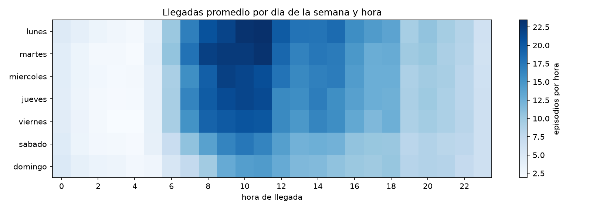
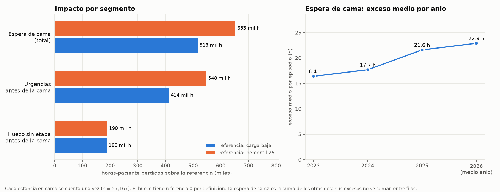
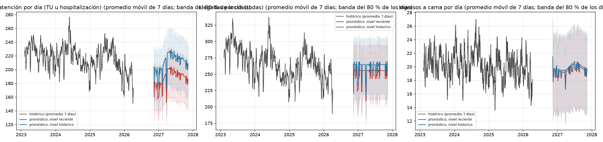
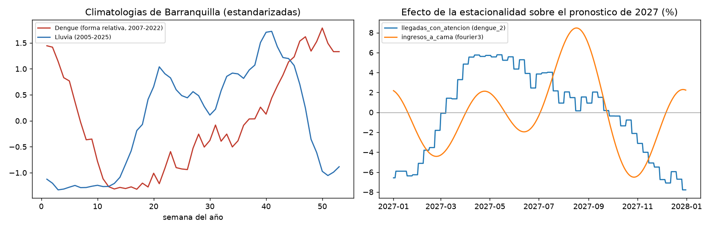
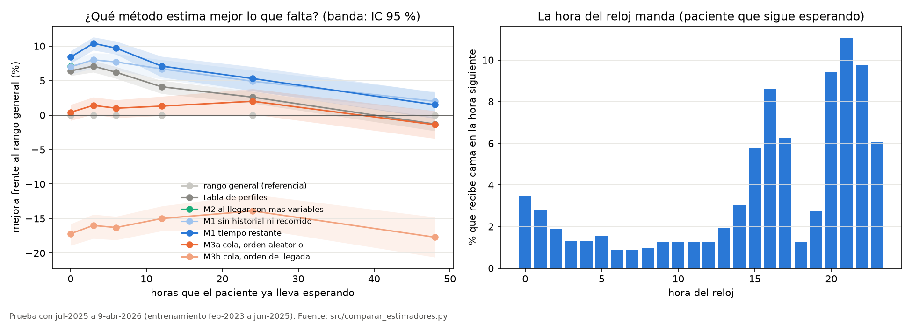

# ¿Por qué se espera tanto por una cama?
## Flujo de pacientes, cuellos de botella y anticipación en el Hospital Universidad del Norte

**Data Challenge HUN 2026** · Hospital Universidad del Norte (HUN) y pregrado de Ciencia de Datos, Universidad del Norte  
**Equipo:** Daniela Amaya (coordinación, datos y análisis), Samuel Amador (estimador de tiempos, recomendaciones y dashboard), Anthony Amaya (modelo explicativo y simulación de camas)  
**Versión:** versión del 17-nov-2026 (estacionalidad anual completa, ficha A9: dengue, IRA y EDA del SIVIGILA; recomendaciones con 38 fuentes verificadas; capítulo 3 reorganizado: tablas y columnas de la base, exploración y limpieza paso a paso, variables y herramientas) · **Entregables:** este documento, el repositorio en GitHub y el dashboard interactivo  

> **Cómo leer este documento.** Cada cifra lleva al lado el documento del repositorio donde se calcula y el script que la produce. Casi todo
> son **asociaciones y escenarios**, no causas probadas, y cada hallazgo lleva su limitación junto a él. Los datos clínicos no están en el
> repositorio: solo el código, las consultas, los documentos y los gráficos.
> **Este documento es la versión completa**, pensada para quien quiera revisar el método. El dashboard cuenta lo mismo resumido para el
> hospital: cada página lleva al pie el enlace a la sección de aquí que la respalda.

---

## Índice
1. [Resumen ejecutivo](#1-resumen-ejecutivo)
2. [El reto y qué abordamos](#2-el-reto-y-qué-abordamos)
3. [Los datos y su calidad](#3-los-datos-y-su-calidad)
4. [Cómo fluye el paciente (componente 1)](#4-cómo-fluye-el-paciente-componente-1)
5. [El cuello de botella y sus factores (componente 2)](#5-el-cuello-de-botella-y-sus-factores-componente-2)
6. [Modelos, predicción y simulación (componente 3)](#6-modelos-predicción-y-simulación-componente-3)
7. [Recomendaciones (componente 4)](#7-recomendaciones-componente-4)
8. [El dashboard](#8-el-dashboard)
9. [Limitaciones](#9-limitaciones)
10. [Trabajo en curso y futuro](#10-trabajo-en-curso-y-futuro)
11. [Anexos: glosario, reproducibilidad, mapa del repositorio y referencias](#11-anexos)

---

## 1. Resumen ejecutivo

**La pregunta del reto:** comprender, predecir y optimizar el flujo de pacientes del hospital, identificando cuellos de botella, patrones
operacionales y oportunidades de mejora en los tiempos de atención. Abordamos los cuatro componentes del instructivo.

**Lo que encontramos, en ocho puntos:**

1. **El cuello de botella es la espera de cama.** Desde que el paciente llega hasta que se le asigna cama pasan, en mediana, **18,6 horas**;
   uno de cada diez espera más de **73,9 horas** y el 43,7 % espera más de un día. El 98 % de ese tiempo transcurre en urgencias antes de
   que se asigne la cama.
2. **Los peores casos empeoran.** La espera mediana casi no cambió entre 2023 y 2026 (17–20 h), pero el percentil 90 pasó de 61 a 81 horas y
   el exceso medio de espera por paciente creció 38 %.
3. **La cama llega en dos olas, por la tarde y por la noche.** El 61 % de las camas se asigna entre las 15 y las 17 h o entre las 20 y las 23 h;
   solo el 9 % en la mañana. El 63 % de las altas sale entre las 14 y las 19 h. Quien llega a media mañana espera hasta la tarde.
4. **Hay un límite de proceso, no solo de camas.** Una cama que se libera en la mañana tarda una mediana de 1,8 horas en volver a asignarse,
   aunque siempre haya unos 26 pacientes esperando.
5. **La ocupación sube porque los pacientes se quedan más, no porque lleguen más.** Las camas ocupadas pasaron de 94 (2023) a 105 (2025),
   frente a 106 camas del hospital; los ingresos se mantienen en ~20 por día y la estancia media subió 16 % (4,6 a 5,3 días).
6. **Se puede anticipar el día y el año:** las llegadas se pronostican con ~8 % de error a una semana y ~10 % a un año, ahora con la forma del
   año (más pacientes a mitad de año, menos en diciembre) tomada de datos públicos de vigilancia (dengue para las llegadas; infección
   respiratoria y diarrea para los ingresos a cama); una alerta a mediodía detecta 13 de cada 15 días
   congestionados; la cola de pacientes sin cama se pronostica a 6–12 h con un tercio menos de error que suponer que todo sigue igual.
7. **La simulación de camas muestra que la estancia es la palanca más barata:** bajar la estancia 5 % reduce los días saturados casi tanto como
   los aumentaría un 10 % más de ingresos.
8. **Se puede estimar cuándo recibirá cama cada paciente.** El estimador mejora el rango ~9 % al llegar y 11 % a las pocas horas, acierta sus
   percentiles y le gana a cinco alternativas. Con la **gravedad (triage) y el servicio** registrados al llegar, la mejora se duplicaría (de 8,4 % a
   16,9 %).

**Lo que proponemos:** registrar mejor (salida de urgencias, asignación de cama, triage, servicio y hora de la orden de hospitalización), una
reunión diaria de camas apoyada en alertas, adelantar las altas **y** asignar enseguida la cama que se libera, una alerta por paciente sin cama
con responsable, y revisar cada semana las estancias largas (sección 7).

---

## 2. El reto y qué abordamos

**Contexto.** El instructivo pide abordar uno o varios de cuatro componentes y valora los hallazgos estratégicos para el hospital, la
interpretabilidad, la visualización efectiva y la comunicación clara que traduzca los análisis en acciones. Los entregables son la
documentación, el repositorio en GitHub y el enlace a un dashboard interactivo (los organizadores aceptaron Dash en lugar de Power BI).

| Componente del instructivo | Qué hicimos | Dónde |
|---|---|---|
| 1. Caracterizar el flujo reconstruyendo las etapas | Limpieza de la base, episodios, rutas, tiempos por etapa | Sección 4; `docs/HALLAZGOS.md` 2–3 |
| 2. Factores de los tiempos y la estancia; cuellos de botella | Definición formal de cuello de botella, ranking, carga, altas tardías, perfiles, diagnósticos, estancias largas, etapas de urgencias | Sección 5 |
| 3. Modelos para estimar tiempos, saturación y patrones atípicos | Pronóstico de demanda, alertas, días atípicos, estimador de espera por paciente, simulación Monte Carlo de camas, pronóstico de la cola, simulador integral | Sección 6 |
| 4. Propuestas accionables | Siete recomendaciones con su cifra, su evidencia externa verificada y su límite | Sección 7 |

**Decisión de enfoque:** la profundidad va en la espera de cama (componente 2) y en los modelos (componente 3); el componente 1 da el contexto y

**La ruta del proyecto, de punta a punta.** Este documento sigue el orden en que se trabajó:

| Etapa | Qué se hizo | Dónde está |
|---|---|---|
| Contexto | El reto, lo que pide el instructivo y las decisiones de enfoque | Sección 2 |
| Extracción | Cómo se obtuvieron los datos de la base del hospital | 3.2 |
| Exploración | Qué hay en la base, tabla por tabla, y qué no trae | 3.1 y 3.3 |
| Limpieza | Visitas copia, estancias duplicadas, etapas abiertas, episodios y la persona real | 3.4 |
| Calidad y validación | El quiebre de abril de 2026 y lo que respondió el hospital | 3.5 y 3.6 |
| Construcción de variables | Calendario, carga, ocupación, diagnóstico y laboratorios | 3.7 |
| Flujo y cuello de botella | Cómo fluye el paciente, dónde se pierde el tiempo y qué factores se asocian | Secciones 4 y 5 |
| Modelos y simulación | Pronóstico, alertas, días atípicos, estimador, simulación de camas y simulador integral | Sección 6 |
| Recomendaciones | Siete acciones con su evidencia y su meta | Sección 7 |
| Dashboard | Cómo se presenta todo al hospital | Sección 8 |
| Límites y futuro | Lo que no sabemos y lo que sigue | Secciones 9 y 10 |
el 4 sale de los dos anteriores.

---

## 3. Los datos y su calidad

Este capítulo sigue el orden en que se trabajó: qué es la base (3.1), cómo se extrajeron los datos (3.2), qué tablas y columnas se usaron (3.3), cómo se exploró y se limpió paso a paso (3.4), qué pasó con el registro en abril de 2026 (3.5), lo que dijo el hospital (3.6), qué variables se construyeron (3.7) y con qué herramientas (3.8). Es la parte **previa a cualquier resultado**: sin ella, las cifras del hospital salían infladas cerca de 40 %.

### 3.1 La base
Base PostgreSQL en el esquema estándar **OMOP** (`uninorte_omop`), de solo lectura y detrás de VPN. Tablas: `visit_occurrence` (1,7 millones de
visitas), `visit_detail` (3,28 millones de etapas), `person` (912 mil personas), `condition_occurrence` (38,6 millones de filas de
diagnósticos), `procedure_occurrence` (47 millones) y `measurement` (16,6 millones de laboratorios). Periodo: enero de 2023 a julio de 2026.

Lo que la base **no** trae, aunque el instructivo lo mencione: servicio, piso o cama; triage; hora de la orden de hospitalización; hora de los
procedimientos (la columna está vacía en toda la tabla); diagnóstico principal; signos vitales; y la duración de la visita (inicio = fin en el
100 %). Las duraciones salen de las **etapas** (`visit_detail`), que son de cuatro tipos:

| Código | Lo llamamos | Qué parece ser |
|---|---|---|
| 9203 | Llegada (ER) | Admisión o triage en urgencias; dura minutos |
| 3045729 | Urgencias (TU) | Atención en urgencias, incluida la observación y la espera |
| 9201 | Cama (HOSP) | Hospitalización; según el HUN, se registra **al asignar la cama** |
| 581479 | Ambulatorio (AMB) | Evento administrativo de duración cero; se descarta |

Cómo se obtuvieron los datos está en 3.2; el detalle de cada tabla y de sus columnas, en 3.3; cómo se exploró y se limpió, en 3.4.

### 3.2 Cómo se extrajeron los datos
**Acceso.** La base es de **solo lectura** y está detrás de una VPN del hospital; las credenciales viven fuera del proyecto y nunca se guardan en el repositorio. Solo existen índices de llave primaria, así que las consultas pesadas
tardan entre 10 y 30 minutos, y como la VPN corta el internet del computador, las consultas largas se corren en segundo plano. La conexión no permite crear tablas temporales: las consultas se escriben con expresiones `WITH`.

**Dos vías de extracción.**
1. **Exportaciones en CSV** con consultas de la carpeta `sql/` (por ejemplo `sql/exportaciones_base.sql` y `sql/consultas_semana1.sql`): las etapas de visita (`visit_detail`), las visitas, las personas, los diagnósticos, procedimientos y laboratorios resumidos **por visita**
   (en SQL, en lugar de exportar las tablas enteras, que pesan decenas de gigabytes) y las consultas de personas y diagnósticos de apoyo.
2. **Revisiones directas de solo lectura** con `src/explorar_bd.py` y `src/auditoria_bd.py` (sobre `src/conexion_bd.py`): sirvieron para comprobar en la base, y no solo en los CSV, hallazgos como el quiebre de abril de 2026 (3.5) o los duplicados.

**Comprobación.** Las exportaciones se verificaron contra la base: las filas y las sumas de los CSV coinciden con las de la base (por ejemplo, 566.004 visitas con diagnósticos y 662.783 con procedimientos, con 38.636.063 y 47.042.032 registros).
**Qué no se publica:** los datos son clínicos, por eso en el repositorio solo hay código, consultas, documentos, gráficos y tablas agregadas.

### 3.3 Las tablas y las columnas que usamos
El esquema real tiene 8 tablas (no las 20 del instructivo). Esta es la lectura de cada una después de explorarla: qué es, qué columnas usamos y qué representan,
y lo que hay que saber antes de confiar en ella. Detalle completo en `docs/CONTEXTO_TECNICO.md` 3 y 4.

| Tabla (filas) | Qué es | Columnas que usamos y qué representan | Lo que hay que saber |
|---|---|---|---|
| `person` (912 mil) | Una fila por paciente | `person_id` (identificador anónimo); `gender_concept_id` (sexo: 53 % mujeres); `year_of_birth` (año de nacimiento, de donde sale la **edad**) | Raza y etnia no sirven (95 % sin dato). 608 mil personas no tienen ninguna visita. |
| `visit_occurrence` (1,7 M) | Una fila por visita | `visit_occurrence_id`; `person_id`; `visit_concept_id` (**tipo de visita**: urgencias 9203, «Treatment urgency» 3045729, ambulatoria 581479, hospitalización 9201); `visit_start_datetime` | Inicio = fin en el 100 %: la visita no tiene duración. El tipo no dice por dónde pasó el paciente (hay visitas «ambulatorias» con hospitalización), por eso se usan todos los tipos. No existen `visit_type_concept_id` ni `preceding_visit_occurrence_id`; `provider_id` es siempre 0. |
| `visit_detail` (3,28 M) | Una fila por **etapa** dentro de la visita | `visit_detail_concept_id` (tipo de etapa: llegada, urgencias, cama, ambulatorio); `visit_detail_start_datetime` y `visit_detail_end_datetime` (**de aquí salen todos los tiempos del proyecto**) | No trae `person_id` (se llega por la visita), ni servicio, piso o cama. Las etapas de urgencias se repiten seguidas (2,5 por estancia) sin información extra; entre el 36 y el 42 % no tiene hora de fin. |
| `condition_occurrence` (38,6 M) | Una fila por diagnóstico registrado | `condition_concept_id` (código **SNOMED**; 37 % sin traducir, concepto 0); `condition_start_datetime` (hora de registro); `person_id` | No hay CIE-10 ni diagnóstico principal (`condition_type_concept_id` siempre 0): se toma el primero con código. Un mismo diagnóstico se repite cientos de veces en una visita: siempre se cuentan conceptos distintos. Se registra tarde (88 % después de las 2 h de llegar): sirve para explicar, no para predecir al llegar. |
| `procedure_occurrence` (47 M) | Una fila por orden: laboratorios, imágenes, cirugías, notas | `procedure_concept_id` (158 conceptos frecuentes) | `procedure_date` está vacía en toda la tabla y no existe `procedure_datetime`: solo conteos por visita, sin poder ubicarlos en el tiempo. «Admission to adult intensive care unit» es la única señal de UCI. |
| `measurement` (16,6 M) | Una fila por componente de laboratorio | `measurement_concept_id` (53 % sin traducir); `measurement_datetime` (**hora de la toma**, válida en el 95 %); `measurement_source_value_extended` (el informe en texto, de donde se extraen valores como troponina o creatinina); `person_id` | La única tabla clínica con hora útil. Cada examen aparece dos veces (SNOMED y LOINC). `value_as_number` casi siempre es 0. No hay signos vitales. |
| `concept` (10 M) | Diccionario de códigos | `concept_id`, `concept_name`, `domain_id`, `vocabulary_id` | Sin índices y sin `concept_code`; no hay `concept_ancestor`, así que los diagnósticos se agruparon a mano en 19 grupos (`datos/referencia/mapeo_dx.csv`). |
| `cups` (94 mil) | Catálogo nacional de procedimientos | — | No enlaza con `procedure_occurrence` (sus códigos son SNOMED, LOINC o ICD9Proc). |

### 3.4 Cómo exploramos y limpiamos la base, paso a paso
1. **Exploración por agregados.** La base es lenta (consultas de 10 a 30 minutos, solo índices de llave primaria), así que nunca se bajaron tablas enteras: cada
   pregunta se resolvió con una consulta agregada por visita en SQL (`sql/`), exportada a CSV y analizada en Python. Antes de usar cada tabla se contaron sus filas,
   sus conceptos, sus fechas nulas y sus rangos; así aparecieron, por ejemplo, el 100 % de procedimientos sin fecha y los 80 diagnósticos con fecha futura. Desde
   noviembre las consultas se lanzan desde Python en segundo plano (la VPN apaga el internet mientras está conectada; `docs/conexion_bd.md`).
2. **Visitas copia (30 %).** Una visita cuyo id es otro id más un desfase fijo (1.746.478 y otros) y con las mismas etapas al segundo. Las de la misma persona se
   borran y su información clínica pasa a la visita original; las de otra persona se conservan como visitas, quitando las etapas que repiten.
3. **Etapas.** Se descartan las ambulatorias (duración cero) y las abiertas en la extracción (fin con milisegundos). Las etapas de urgencias seguidas se juntan en
   un bloque para medir; las que tienen inicio = fin se marcan sin duración, no como cero.
4. **Episodios.** Una atención continua de un paciente; se corta un episodio nuevo cuando pasan más de 168 h sin etapas. Con esto desaparece el «desfase de 16 días»
   que vivía en las copias. Resultado: 337.194 episodios.
5. **Estancias gemelas (41 % de los hospitalizados).** La misma estancia en cama registrada en dos personas. Regla v3.8: los registros que comparten el inicio y el fin
   de cama, o algún intervalo de cama idéntico al segundo, son una sola estancia (25.777 estancias únicas). Sin esta regla el hospital parecía tener 146 camas ocupadas.
6. **Persona real (regla v4.0).** De cada estancia gemela se conserva el registro de la persona que domina en sus diagnósticos y laboratorios (identificada en el
   97,6 %); así la edad y el sexo son los correctos. Los diagnósticos y laboratorios se filtran siempre por esa persona.
7. **Periodo confiable.** Del 1-feb-2023 al 9-abr-2026, sin el 28 y 29 de marzo de 2026 (caída del registro). Después del 10-abr el registro de etapas se degrada y
   no se usa para estimar niveles ni errores.
8. **Verificación.** Una auditoría de 29 consultas directas en la base (altas por hora, ingresos, copias, camas ocupadas) reproduce las cifras del pipeline con otro
   método, y el pipeline completo se regeneró desde cero en un clon limpio del repositorio.

**Los problemas, en resumen:**

| Problema | Tamaño | Qué se hizo |
|---|---|---|
| Visitas copia (mismo contenido con otro id) | ~30 % de las visitas | Se borran las de la misma persona y su información pasa a la visita original |
| **Estancias en cama duplicadas en dos personas** | 41 % de los hospitalizados | Cada estancia se cuenta una vez (regla v3.8: 25.777 estancias únicas) y se conserva la **persona real**, identificada por quién domina los diagnósticos y laboratorios en el 97,6 % de los casos |
| Etapas de urgencias sin hora de salida | 36–42 % | Se marcan sin duración (no como 0 h); la duración de urgencias de quien se va de alta solo se describe, con métodos de supervivencia |
| Etapas abiertas al momento de la extracción | 2.053 | Se descartan |
| **Registro de etapas degradado desde el 10-abr-2026** | La etapa de llegada cae de 65 % a 30 % de las visitas mientras las visitas no bajan | Se usa solo el **periodo confiable: 1-feb-2023 a 9-abr-2026** |
| Caída de todo el registro el 28 y 29 de marzo de 2026 | 14 y 118 visitas (lo normal: 400–600) | Se excluyen |

**Por qué importa:** sin esta limpieza el hospital parecía tener ~146 camas ocupadas y 27,7 ingresos por día; los valores reales son ~100 camas y
~20 ingresos. La auditoría directa en la base (2-nov) y la reproducción del pipeline en un clon limpio confirmaron las cifras.
Detalle: `docs/CONTEXTO_TECNICO.md` 4.1–4.13; `docs/HALLAZGOS.md` 2; `src/analisis_etapas.py`, `src/preparar_variables.py`, `src/auditoria_bd.py`.

**Resultado:** 337.194 episodios (atención continua de un paciente; se corta tras 168 h sin etapas). En el periodo confiable, 22.819 estancias
únicas con espera de cama medida.

### 3.5 El quiebre de abril de 2026 y lo que pasaba en el sistema de salud
La auditoría en la base (`docs/CONTEXTO_TECNICO.md` 4.9) muestra que desde el 10-abr-2026 las visitas de urgencias **suben ~40 %** mientras el registro de etapas se
degrada: no es menos demanda. El hospital no explicó la causa. Para el contexto se revisaron prensa y actos de la Superintendencia de Salud
(`docs/estacionalidad_anual.md`, cuarta ronda):
- **Oct-2023:** abre el Hospital Juan Domínguez Romero en Soledad, el mismo municipio del HUN. **Ene-2025:** abre el Nuevo Hospital de Barranquilla
  (122 camas de hospitalización y urgencias).
- **Ago-2025:** la Supersalud interviene la ESE Universitaria del Atlántico (red pública del departamento) por 49 hallazgos críticos, entre ellos
  fallas en urgencias.
- **Abr-2026:** la Supersalud prorroga la intervención de Nueva EPS; desde el 22-abr la Clínica General del Norte (Barranquilla) suspende las cirugías
  programadas por la cartera de las EPS, y varias clínicas acumulan deudas de más de 90 días con sus médicos.

**Lectura:** la crisis financiera de abril de 2026 pudo llevar pacientes de otras clínicas al HUN, lo que encaja con el aumento de visitas, pero las
fechas no coinciden exactamente (10-abr frente a 22-abr) y no se puede comprobar con los datos. Queda como hipótesis, no como causa; la decisión de
usar solo el periodo confiable no cambia.

### 3.6 Lo que dijo el hospital (sesión del 29-oct-2026)
106 camas de hospitalización (88 de adultos y 18 de niños) y 58 camillas de urgencias; la hospitalización se registra al asignar la cama; las
estancias en dos personas «probablemente son duplicados»; hay horarios y costumbres de alta. No dieron la meta de tiempos ni la causa del cambio
de registro de abril de 2026. No hubo más sesiones.

### 3.7 Las variables que construimos y qué representa cada una
Todo sale de `src/analisis_etapas.py` y `src/preparar_variables.py` en una tabla con una fila por episodio (`tabla_episodios`). Las columnas que más se usan:

| Variable (columna) | Cómo se calcula | Qué representa | Qué peso tiene en los resultados |
|---|---|---|---|
| `espera_cama_h` | `ini_hosp_est − ini_est`: inicio de la primera etapa de cama de la **estancia** menos la llegada más temprana | Horas desde que el paciente llega hasta que se le asigna cama. Es la variable central del proyecto | Mediana 18,6 h, p90 73,9 h; el 98 % de ese tiempo transcurre en urgencias |
| `estancia_h` (`fin_hosp_est − ini_hosp_est`) | Fin menos inicio de la cama, de toda la estancia | Horas en cama | Media de 4,6 a 5,3 días entre 2023 y 2025: explica el aumento de la ocupación |
| `estancia_unica`, `estancia_id`, `n_registros_estancia`, `persona_real` | Marcas de las reglas v3.8 y v4.0 | Si el registro es el que cuenta la estancia y quién es la persona real | Para espera, camas e ingresos se filtra `estancia_unica`; sin filtrar, todo sale inflado |
| `ruta`, `ruta_simple`, `hospitalizado`, `estado` | Secuencia de bloques (llegada > urgencias > cama) y si la duración es confiable (`medida`, `minimo_conocido`, `minimo_dx`, `sin_duracion`, `sin_actividad`) | Por dónde pasó el paciente y qué tan completo está su registro | Solo los episodios `medida` entran a los tiempos; la espera de cama está medida en el 100 % de los hospitalizados |
| `hora`, `franja`, `dia_semana`, `festivo`, `fin_de_semana`, `anio`, `mes` | Calendario de la llegada (festivos de Colombia con `holidays`) | Cuándo llegó | La hora de llegada manda (madrugada 12–15 h, tarde ~25 h); el día de la semana y los festivos casi nada |
| `edad`, `grupo_edad`, `sexo` | De `person`, con la persona real | Quién es el paciente | 4,1 puntos de R² de la espera; las mujeres esperan +27 %; la estancia sube con la edad |
| `tipo_visita` | `visit_concept_id` | Por dónde entró al sistema | Ambulatoria −31 % y «Treatment urgency» −39 % de espera frente a urgencias |
| `dx_concept_id`, `dx_nombre`, `categoria_dx`, `n_dx_distintos` | Primer diagnóstico con código por fecha; grupo de `mapeo_dx.csv` | De qué se le atiende | 7,2 puntos de R²; registrado tarde, explica pero no predice |
| `n_proc_distintos`, `n_lab`, `n_lab_6h`, `n_lab_antes_hosp` | Conteos de procedimientos y laboratorios (total y primeras 6 h) | Cuánta actividad clínica tuvo | El total crece con la estancia (causalidad inversa): como factor solo vale `n_lab_6h` |
| `ocup_hosp`, `ocup_tu`, `ocupacion_confiable` | Pacientes en cama y en urgencias en el momento de llegar, con estancias únicas | Qué tan lleno estaba el hospital | +7 % de espera por cada 10 camas más; mueve el p90, no la mediana |
| `llegadas_6h_previas`, `llegadas_24h_previas` | Llegadas en las 6 y 24 h anteriores | Carga reciente de urgencias | Mediana de 14 h en el decil más tranquilo a 26 h en el más cargado |
| `reingreso_72h`, `reingreso_30d`, `n_episodios_previos`, `dias_desde_anterior` | Vuelve en 72 h o 30 días tras una atención con actividad | Reingresos y historial | 5,3 % y 14,1 % depurados; la espera anterior predice la siguiente (Spearman 0,34) |
| `hueco_antes_hosp_h` | Tiempo sin ninguna etapa justo antes de la cama | Posible registro faltante | 1,1 % de las horas (lo que parecía 21 % era un artefacto de las gemelas) |

Además de la tabla hay variables que se calculan **en el momento**, para los modelos: el **recorrido en urgencias** (etapas iniciadas y cerradas, horas desde la
última), el **historial** de la persona (espera y estancia de su hospitalización anterior), la **cola** y la **ocupación por zona** hora a hora, las **banderas de
laboratorio** de las primeras 6 h (11 valores con punto de corte clínico) y, para el pronóstico, las series diarias de llegadas, llegadas con atención e ingresos a
cama con su calendario y su forma del año. El diccionario de las tablas pequeñas que alimentan el dashboard está en `datos/tablas_dashboard/diccionario_tablas.md`.

### 3.8 Herramientas y por qué estas
| Herramienta | Para qué | Por qué esta |
|---|---|---|
| PostgreSQL con SQL (CTE), DBeaver al inicio y después SQLAlchemy + psycopg desde Python | Consultas agregadas de solo lectura, en segundo plano por la VPN | La base no permite tablas temporales y es lenta: agregar en SQL y exportar lo mínimo evita bajar tablas de 15 GB |
| Python 3.14 con pandas, numpy y pyarrow | Todo el pipeline de limpieza y análisis | Reproducible: la tabla de episodios se regenera idéntica en menos de un minuto; parquet guarda 300 mil episodios con tipos correctos |
| statsmodels | Regresiones explicativas: OLS sobre el logaritmo de la espera, logística para «esperar más de 24 h», Poisson para las llegadas | Coeficientes interpretables con intervalos y errores robustos; es lo que un hospital puede leer |
| scikit-learn (`HistGradientBoosting`) | El estimador de tiempo restante por paciente | Maneja valores faltantes y categorías, entrena en segundos con 700 mil filas paciente-hora, y da probabilidades calibradas; LightGBM, XGBoost y 13 variantes más llegaron al mismo nivel (6.8) |
| scipy y numpy | Bootstrap por semanas, Poisson, Kaplan-Meier, Monte Carlo de camas | Los intervalos de confianza de todo el proyecto salen de bootstrap, no de supuestos de normalidad |
| holidays | Festivos de Colombia | El calendario entra en el pronóstico y en los factores |
| Dash y Plotly | El dashboard | Mismo lenguaje que los modelos: el estimador y la simulación corren en vivo sobre tablas agregadas, sin conexión a la base ni filas por paciente. Los organizadores aceptaron Dash en lugar de Power BI el 1-nov; Power BI no podía correr el modelo ni actualizarse sin exportar tablas |
| matplotlib | Gráficos estáticos del repositorio | Se versionan en GitHub como evidencia de cada análisis |
| Git y GitHub | Trabajo del equipo con una rama por persona y tarea | Cada análisis queda con su script, su documento y su commit; los datos clínicos nunca se suben |

---

## 4. Cómo fluye el paciente (componente 1)

- **Llegadas:** ~265 episodios por día. Pico entre las 9 y las 11 h, mínimo de 3 a 4 h; el lunes es el día más cargado y el fin de semana llega
  ~30 % menos. Incluyen ~4 % de réplicas de registro, estables en el tiempo (no se deduplican).
- **Recorrido:** llegada (minutos) → urgencias → cama. Solo ~1 de cada 8–10 atendidos se hospitaliza (~20 ingresos a cama por día).
- **Urgencias sin hospitalizar:** con supervivencia (Kaplan-Meier) la mediana es de ~11 h y el percentil 90 de 71–81 h; quedarse solo con los
  que tienen hora de salida la subestima (`docs/supervivencia_urgencias.md`).
- **Estancia en cama:** mediana de 71 h, percentil 90 de 280 h, media de 5,2 días.
- **Entre etapas casi no hay tiempo muerto:** el «hueco sin registro» antes de la cama que se creía del 21 % resultó un artefacto de las estancias
  duplicadas; en el registro de la persona real es ~1 % de las horas (`docs/CONTEXTO_TECNICO.md` 4.12).
- **Reingresos depurados:** 5,3 % en 72 h y 14,1 % en 30 días (`docs/c4_reingresos_huecos_llegadas.md`).

---

## 5. El cuello de botella y sus factores (componente 2)

### 5.1 Definición
Un segmento del recorrido es **cuello de botella** si (1) es una espera y no atención clínica, (2) tiene exceso sobre una referencia de «cuando
el hospital funciona bien» (la mediana con carga baja), (3) tiene impacto alto (volumen × retraso) y (4) se agrava con la carga. El orden de los
resultados no cambia con cuatro referencias distintas ni con tres cortes de episodio (`docs/plan_de_accion.md`; `src/ranking_cuellos.py`).

### 5.2 La espera de cama es el cuello de botella

| Segmento (estancias únicas) | n | Mediana | p75 | p90 |
|---|---|---|---|---|
| **Espera de cama** | 25.373 | **18,6 h** | 37,9 h | **73,9 h** |
| Urgencias antes de la cama | 25.373 | 11,1 h | 29,5 h | 55,9 h |
| Estancia en cama | 25.777 | 70,7 h | 143,9 h | 280,3 h |

- El **64 %** de las horas de espera (518 mil de 812 mil horas-paciente) está por encima de la referencia de carga baja.
- El 83 % de las horas de espera viene de esperas de más de 24 h, y el 57 % de esperas de más de 48 h (el 19 % de los pacientes).

### 5.3 Los peores casos empeoran

| Año | Mediana | p90 | Exceso medio por paciente |
|---|---|---|---|
| 2023 | 19,5 h | 61,6 h | 17,3 h |
| 2024 | 18,3 h | 69,7 h | 18,6 h |
| 2025 | 17,4 h | 80,2 h | 23,8 h |
| 2026 (ene–9 abr) | 19,8 h | 81,9 h | 23,8 h |

### 5.4 La hora del día manda más que el número de camas
- **Altas tardías (hipótesis sostenida en 4 de 4 criterios):** el 62,7 % de las altas ocurre entre las 14:00 y las 18:59 y solo el 14 % antes del
  mediodía. Quien llega a las 8 h recibe cama al día siguiente en el 50 % de los casos; a las 16 h, en el 72 %.
- **La cama llega en dos olas:** 23,8 % entre las 15 y las 17 h y 37,5 % entre las 20 y las 23 h (61 % juntas); 8,9 % entre las 6 y las 11 h.
  Parte de la ola nocturna podría ser la hora en que se digita en el sistema.
- **Límite de proceso:** una cama liberada entre las 6 y las 12 h tarda una mediana de 1,8 h en volver a asignarse (un tercio tarda más de 3 h),
  aunque haya ~26 pacientes esperando; las de la tarde tardan 0,4 h (`docs/saturacion_y_espera.md` 3).
- **El orden de llegada casi no predice el orden de cama** (53 % de pares en orden; el azar daría 50 %): no hay una fila única.

### 5.5 La saturación mueve la cola larga, no la espera típica
- El hospital está saturado casi siempre: en adultos nunca hay una hora sin pacientes esperando cama y el 75 % de las horas tiene el 90 % o más de
  las camas ocupadas.
- Cada 10 camas ocupadas más al llegar suben la espera ~7 % (adultos +7,2 %, IC 95 % +3,5 a +11,1); la **mediana casi no cambia** (18,7 h con
  ≤ 90 camas, 19,8 h con más de 115) pero el **p90 pasa de 60 a 80 h** (`docs/saturacion_y_espera.md`).
- La cola de pacientes esperando cama (media de 26) no depende de la ocupación: no se puede estimar un «techo» de camas desde los datos
  (`docs/capacidad_efectiva.md`).
- **La ocupación sube por la estancia:** 94 → 101 → 105 camas (2023–2025) con ingresos estables (20,6 → 19,8 por día) y estancia media de 4,57 a
  5,31 días. Con la ley de Little, volver a la estancia de 2023 liberaría ~15 camas. El exceso sobre las 106 camas está en **adultos** (101 % de
  sus 88 camas en 2025) y viene de estancias largas con actividad clínica diaria, no de camas «fantasma» (`docs/ocupacion_por_zona.md`,
  `docs/dias_cama_baja_actividad.md`). Pasar de 106 puede ser sobreocupación o una capacidad real mayor; los datos no lo distinguen.

### 5.6 Dónde se va el tiempo dentro de urgencias
- Cada estancia tiene en promedio 2,5 etapas de urgencias seguidas. **El tiempo extra de las esperas largas está en la última etapa antes de la
  cama:** 53 % de la espera en quienes esperan menos de 6 h, 63 % entre 12 y 48 h y **78 %** en quienes esperan más de 72 h (mediana de 69 h).
- En esa última etapa hay ~1 laboratorio cada 10 h y casi ningún diagnóstico nuevo: es compatible con un paciente ya decidido que espera cama.
  **Hipótesis:** la base no dice qué es cada etapa (`docs/caracterizacion_etapas_tu.md`, `docs/etapas_tu_por_examen.md`).

### 5.7 Qué factores se asocian a la espera y a la estancia

**Espera de cama** (modelo sobre el logaritmo, R² = 16 %: el 84 % de la variación no se explica con lo observado; `docs/HALLAZGOS.md` 4.5):
diagnóstico 7,2 puntos de R², edad y sexo 4,1, tipo de visita 2,0, hora de llegada 0,6, carga y año 0,1 cada uno, calendario ~0.

**Modelo explicativo de A4** (regresión logística sobre «esperar más de 24 h», validada en tres tramos temporales; `docs/modelo_espera.md`):
AUC de 0,68 en la prueba de 2026. Esperan más los de 30 a 59 años (OR 1,6–1,8 frente a 15–29), las **mujeres (OR 1,37)** y quienes llegan con
más carga reciente (OR 1,25 por desviación); esperan menos los niños de 0 a 4 años (OR 0,40) y las visitas ambulatorias (OR 0,16). Su valor
está en explicar qué perfiles esperan más; para avisar paciente por paciente se usa el estimador de la sección 6.4.

**Quién es el paciente** (`docs/que_esperar_segun_paciente.md`, `docs/perfiles_pacientes.md`):

| Característica | Espera de cama (mediana) | Estancia en cama (mediana) |
|---|---|---|
| Edad | Niños 0–4: 7,8 h; 5–14: 12,3 h; 15–29: 17,2 h; desde 30: 24–27 h | Sube con la edad: 52–68 h hasta los 44; 103 h desde los 75 |
| Sexo | **Mujeres 22,3 h frente a 14,3 h** (+27 % con todo controlado) | Sin diferencia |
| Tipo de visita | Urgencias 20,8 h; «Treatment urgency» 9,8 h; ambulatoria 11,3 h | «Treatment urgency» 112 h (+63 %) |
| Hora de llegada | Madrugada 12–15 h; tarde ~25 h | Sin efecto |

- **Hallazgo abierto:** las mujeres esperan cama +27 % más (IC 23 a 31 %) controlando edad, tipo de visita, franja y año. No es obstetricia (sin
  embarazo ni ginecología la diferencia crece) ni la saturación del momento. Hipótesis sin comprobar: camas agrupadas por sexo. No es una rareza
  del HUN: en dos hospitales de Boston (38.766 ingresos) las mujeres también tienen más probabilidad de esperar 4 h o más por una cama (OR 1,08;
  Olson y colegas, *J Hosp Med* 2025), aunque la brecha del HUN es mucho mayor.
- **Diagnóstico** (`docs/diagnosticos_todos.md`, 69 % de las estancias con diagnóstico de la persona real): esperan menos cardiovascular,
  neurológico y respiratorio (~9–13 h); más musculoesquelético (+64 % ajustado), renal, cáncer y digestivo (29–39 h). El diagnóstico se
  registra tarde: sirve para explicar, no para predecir al llegar.
- **Gravedad y servicio** (desde los procedimientos de cada estancia, sin fecha): UCI recibe cama en una mediana de 2,7 h; urología (37,7 h),
  ortopedia (32,8 h) y cirugía general (29,6 h) esperan más.
- **Laboratorios de las primeras 6 h** (`docs/espera_con_labs_y_severidad.md`): con troponina alta la espera es 42 % menor; con BUN o lactato
  alto ~16–17 % menor; con PCR alta 16 % mayor y con creatinina alta 13 % mayor. Sumados se cancelan; por separado ayudan al estimador.

**Estancia larga** (`docs/factores_estancia.md`, `docs/estancias_disparadas.md`): la estancia media subió 16 % y **cerca de la mitad del aumento
viene de las estancias de más de 30 días** (de 63 a 117 por año). Las largas (más de 14 días, 6,5 %) se asocian con la edad (×3 desde los 75 años),
la visita «Treatment urgency» (×2,4) y diagnósticos de cáncer, infecciosas y salud mental. Quien entra a cama un sábado se queda 12 % más
(`docs/efecto_fin_de_semana.md`).

### 5.8 Lo que no explica la espera
El día de la semana y los festivos casi no la cambian; ningún día tuvo una espera más alta de lo esperado (el problema es crónico, no de días
puntuales; `docs/dias_atipicos.md`); las camas de baja actividad clínica son ~6 y no crecen.

---

## 6. Modelos, predicción y simulación (componente 3)

Construimos un conjunto de herramientas que permiten **anticipar** lo que va a pasar en el hospital: cuántos pacientes llegarán, qué días se
congestionará urgencias, cuándo recibirá cama cada paciente, qué pasaría con las camas en distintos escenarios y, con el simulador integral (6.9), cómo se mueven a la vez la demanda, la cola y la ocupación cuando se cambia una decisión. Todas se validaron con el método más
exigente: entrenar con el pasado y probar con meses que el modelo nunca vio, y siempre frente a una referencia simple para demostrar que aportan.

**Por qué estos modelos y no otros.** Para cada pregunta se eligió el método más simple que diera el mejor resultado en datos que no había visto, y que un
hospital pudiera leer:

| Pregunta | Modelo elegido | Por qué | Lo que se descartó (6.8) |
|---|---|---|---|
| ¿Cuántos pacientes llegan y cuántos van a cama cada día? | Regresión de Poisson con día de la semana, festivos, Carnaval, nivel reciente y forma del año | Son conteos; cada efecto se lee como un porcentaje; error de 7,9 % a 1–7 días | SARIMAX y otros modelos de series (peor a corto plazo), quincenas, deduplicar llegadas |
| ¿Hoy será un día congestionado? | Clasificador logístico sobre lo que ya llegó hasta las 12 h, mezclado con el pronóstico | Simple y con AUC de 0,94; avisa a media jornada | Alerta un día antes (AUC 0,61) |
| ¿Cuándo recibirá cama este paciente? | Supervivencia hora a hora con árboles de gradiente (un modelo por hora de espera) | Da la distribución completa del tiempo que falta y se actualiza con lo que pasa; percentiles calibrados | Fila «primero en llegar» (el orden no se cumple), cuantiles al llegar, modelo de cola, LightGBM y XGBoost (mismo nivel) |
| ¿Qué perfiles esperan más y por qué? | Regresión logística y regresión sobre el logaritmo de la espera | Coeficientes interpretables con intervalos; explica, no reemplaza al estimador | Alertar por riesgo al llegar (marcaría al 44 % con 4 de cada 10 falsas alarmas) |
| ¿Se van a saturar las camas? | Simulación Monte Carlo con estancias reales por perfil (edad y ruta) sobre los ingresos pronosticados | Respeta la cola larga de las estancias y da probabilidades de superar las 106 camas; cobertura 86 % en el backtest | Predecir la estancia de cada paciente (R² ≈ 0), proyección con altas esperadas (peor que «lo mismo que ahora») |
| ¿Cuántos esperarán cama en 6–12 h? | Modelo de flujo (entradas y salidas de la cola) | Un tercio menos de error que suponer que todo sigue igual | Persistencia y tasa típica |
| ¿Cómo se mueven a la vez la demanda, la cola y las camas? | Un solo motor de agentes (simulador integral) que sigue a cada paciente simulado | Las tres vistas salen del mismo paciente y se validaron contra la cola y la ocupación reales | Encadenar pronóstico, estimador y Monte Carlo en serie (6.9) |

### 6.1 Pronóstico de demanda (`src/modelo_pronostico.py`; página de pronóstico del dashboard)
Un modelo de Poisson que combina el calendario (día de la semana, festivos, semana santa, fin de año y el **Carnaval de Barranquilla**, que reduce las
llegadas ~17 %) con **la forma del año** tomada de datos públicos de vigilancia.
- **Llegadas con atención:** error de **8,0 % a una semana y 9,6 % a un año**. Con unos 200 pacientes al día, a un año el pronóstico se equivoca en unos
  19 pacientes diarios.
- **Ingresos a cama:** error de **9,5 % por semana**, que es como se planean las camas. A nivel diario el error (~18 %) está prácticamente en el mínimo que
  permite el azar en un conteo de ~20 ingresos al día.
- **Rango probable del 80 %:** en meses que el modelo no vio cubre el 78–82 % de los días en las llegadas, justo lo que promete; en los ingresos es
  conservador.

**La forma del año (ficha A9, `docs/estacionalidad_anual.md`).** Con solo tres años de datos del hospital no se puede aprender qué épocas del año traen
más pacientes, así que la tomamos de **datos públicos de muchos años** y la validamos con datos que el modelo no conocía:
- **En las llegadas, la forma del año del dengue en Barranquilla** (2007–2022, SIVIGILA, publicada por Drexel, Los Andes y Uninorte) **bajó el error a largo
  plazo de 11,6 % a 9,6 %** (de 11,4 % a 9,1 % a 3–6 meses), sin afectar el corto plazo. Funciona como un marcador de la temporada del año.
- **En los ingresos a cama, la forma del año de la infección respiratoria aguda (IRA) y la diarrea aguda (EDA)**, que obtuvimos de los microdatos
  oficiales del SIVIGILA del Instituto Nacional de Salud, **mejora todos los horizontes y se confirmó en 2026**, un periodo que no se usó para elegirla
  (19,8 % → 19,3 % a 1–6 meses). Las dos enfermedades tienen el pico en junio, en la temporada de lluvias, igual que la demanda de camas.
- **Rigor:** se evaluaron todas las fuentes que pedía la ficha (lluvia de NASA y del IDEAM, temperatura, calendario escolar oficial, El Niño, población
  del DANE) y un modelo más complejo (SARIMAX); solo se adoptó lo que mejoró en datos nuevos. Por eso el modelo sigue siendo un Poisson
  interpretable: cada variable tiene un efecto que se puede leer.

| Error diario (WAPE) | 1–7 días | 1–3 meses | 3–6 meses | 6–12 meses |
|---|---|---|---|---|
| Llegadas con atención, sin forma del año | 8,0 % | 9,3 % | 11,4 % | 11,6 % |
| **Llegadas con atención, con dengue (vigente)** | **8,0 %** | **8,6 %** | **9,1 %** | **9,6 %** |
| Ingresos a cama, con curva del año | 18,2 % | 19,3 % | 19,7 % | 19,4 % |
| **Ingresos a cama, + IRA y EDA (vigente)** | **18,0 %** | **18,7 %** | **19,3 %** | **19,0 %** |

### 6.2 Alertas (`src/alertas.py`, probadas reproduciendo días de 2026)

| Alerta | Resultado |
|---|---|
| A. Día congestionado, a las 12 h | **Detecta 13 de cada 15 días congestionados** (AUC 0,94), con apenas una alerta cada cuatro días |
| B. Ocupación alta a 24 h | AUC 0,82: identifica 3 de cada 4 días con ocupación alta |
| C. Paciente sin cama a las 48 h | ~4 alertas por día; la mitad de esos pacientes terminaría esperando más de 72 h, así que avisa con 24 h de margen |

En conjunto son unas 4–5 alertas al día: una carga manejable para una reunión diaria de camas.

En el dashboard, la página **Alertas** (categoría Riesgo) muestra la prueba de cada alerta, y el **simulador integral** (6.9) las dispara mientras corre, con la recomendación de la que se derivan. Cada alerta apunta a una o más de las siete recomendaciones (sección 7): día congestionado y ocupación alta, a la reunión diaria de camas y a adelantar las altas; paciente sin cama, a la alerta con responsable.

### 6.3 Días atípicos (`src/dias_atipicos.py`)
El modelo identifica automáticamente los días que se salen de lo esperado (14 de llegadas, 9 de ingresos y 7 de espera). Los más extremos coinciden con
cortes de registro, lo que también sirve para vigilar la calidad de los datos. Un hallazgo útil: ningún día tuvo una espera fuera de lo normal, así que
el problema de la espera es estructural, no de días puntuales.

### 6.4 Estimador de la espera de cada paciente (A6; `docs/estimador_tiempos.md`; página «Paciente en espera»)
- **Qué hace:** para un paciente que ya tiene orden de hospitalización y espera cama, estima cuánto le falta (con su rango) y la probabilidad de recibir
  cama en 6, 12 y 24 horas, y se actualiza hora a hora mientras espera. Usa un modelo de supervivencia en tiempo discreto con árboles de gradiente.
- **Qué usa:** edad, sexo, tipo de visita, la hora, la ocupación del hospital, el historial del paciente, su recorrido en urgencias y, desde las 6 horas,
  las alertas de sus laboratorios.
- **Resultado** (probado con 5.430 estancias de jul-2025 a abr-2026 que el modelo no vio): mejora el rango **9,2 % al llegar y 11 % entre las 3 y las 6
  horas** frente a darle a todos el mismo rango, y le gana a cinco alternativas, incluidos modelos hechos desde cero con LightGBM y XGBoost. Su
  percentil 90 está bien calibrado (cubre ~91 %).
- **Extrae todo lo que permiten los datos:** más de 15 enfoques distintos llegan al mismo nivel. Si el hospital registrara la **gravedad y el servicio**
  al llegar, la mejora se duplicaría (de 8,4 % a 16,9 %).
- **Uso diario:** responde en ventanas del día («esta tarde», «mañana en la noche»); da el censo para la reunión de camas (cuántos de los que esperan
  tendrán cama en 12 o 24 horas, con un rango que acierta el 87–88 % de los días); y avisa a las 12 horas quién seguirá sin cama a las 48 (4 por día,
  con 12 horas más de margen que esperar a las 24).

### 6.5 Simulación Monte Carlo de camas (A5; `docs/modelo_camas.md`, `docs/simulacion.md`)
**Qué responde:** ¿cuántas camas estarán ocupadas en los próximos meses, qué tan seguido se superará la capacidad del hospital y qué pasaría si
cambian los ingresos o la estancia? Es la pregunta del instructivo sobre «el efecto de cambios operativos en la ocupación y la disponibilidad de camas».

**Cómo funciona.** Se simulan los próximos 180 días 1.000 veces. Cada día, el número de ingresos sale de una distribución de Poisson alrededor del
pronóstico de demanda (sección 6.1); a cada paciente se le asigna un **perfil real** (grupo de edad y ruta de llegada: urgencias, «Treatment urgency»
o ambulatorio, con la mezcla real de 2025) y una estancia tomada al azar de pacientes reales con ese mismo perfil (2024–2025, 21 combinaciones de edad
y ruta). Así la simulación respeta que los mayores de 75 años se quedan una mediana de 100 horas frente a 59 de los jóvenes, y que la ruta «Treatment
urgency» se queda 63 % más. El censo se separa en **adultos (88 camas) y niños (18 camas)** con el desglose que dio el hospital.

**Validación (puerta de decisión de la ficha).** Entrenada solo hasta diciembre de 2025 y probada en enero a abril de 2026, la ocupación real cayó
dentro de la banda del 80 % el **78,8 % de los días** (la meta era 70–90 %), con un error medio de 8,6 camas sobre una ocupación de ~105, es decir
~7 %. El modelo predice bien porque pronostica un número agregado (todo el hospital), donde el ruido de cada paciente se compensa.

**Riesgo de saturación en los próximos 180 días:**

| Grupo | Capacidad | Días en que se supera (promedio del horizonte) |
|---|---|---|
| Total del hospital | 106 camas | **65 %** |
| Adultos | 88 camas | **71 %** |
| Niños y neonatos | 18 camas | 35 % |

El resultado es robusto: con un umbral independiente del dato del hospital (el percentil 90 de la ocupación real observada, 109,5 camas) el riesgo sigue
siendo alto (55 %). La presión está en los adultos, que en 2025 ya operaron en promedio al 100 % de sus camas.

**Escenarios «¿qué pasaría si…?»:**

| Escenario | Ocupación media | Días saturados (total) | Lectura |
|---|---|---|---|
| Hoy, sin cambios | 111,1 camas | 65 % | Punto de partida |
| Ingresos +10 % (brote o temporada alta) | 121,9 camas | 91 % | El escenario más costoso: 9 de cada 10 días saturados |
| **Estancia −5 %** | **106,2 camas** | **48 %** | Libera ~5 camas sin necesitar ninguna nueva |
| Ruta «Treatment urgency» del 13,5 % al 27 % | 118,1 camas | 85 % | Si sigue creciendo como entre 2023 y 2025 |

**La estancia es la palanca más barata:** bajarla apenas 5 % mueve la ocupación casi tanto como la subiría un 10 % más de pacientes. La ley de Little
llega al mismo número (~5 camas) por un camino distinto, y tres versiones del simulador coinciden: eso da confianza en la cifra. La simulación también
dice **dónde mirar**: los mayores de 60 años (se quedan 33–46 % más), la ruta «Treatment urgency» y las estancias de más de 30 días, que explican la
mitad del aumento de la estancia.

**Curva de capacidad.** En lugar de preguntar si «más camas ayudan», la simulación calcula cuántas harían falta para que el riesgo de saturación baje a
10 % o menos: **~126 camas en total (+20)**, de las cuales 108 serían de adultos (+20) y 22 de niños (+4). El umbral de riesgo es un parámetro: el
hospital puede recalcularlo para el nivel que considere aceptable, y en el dashboard se mueve con un control.

### 6.6 Pronóstico de la cola de pacientes sin cama y de la espera del sistema (`docs/pronostico_espera_sistema.md`)
**Qué responde:** ¿cuántos pacientes seguirán esperando cama dentro de unas horas, y cuánto esperará en promedio quien llegue hoy? Es el complemento
de la simulación de camas: aquella mira las camas ocupadas; esta mira la fila de pacientes que esperan una.

**El modelo de flujo.** La cola de dentro de unas horas es la cola de ahora, más las llegadas que terminarán en hospitalización, menos las camas que el
hospital suele asignar a esa hora y ese día de la semana. En la prueba (julio de 2025 a abril de 2026, una cola media de 28 pacientes):

| Horizonte | «Lo mismo que ahora» | **Modelo de flujo** | Mejora |
|---|---|---|---|
| 6 horas | 3,8 pacientes de error | **2,6** | **−33 %** |
| 12 horas | 5,5 | **3,5** | **−36 %** |
| 24 horas | 4,5 | **4,1** | −9 % |

A diferencia de la proyección de camas ocupadas a 24 horas, aquí el modelo sí le gana con claridad a suponer que todo sigue igual, justo en el horizonte
que le sirve a la reunión de camas de la mañana.

**De la cola a la espera: la ley de Little.** Se hospitalizan 0,85 pacientes por hora y la cola media es de 25,8, así que la espera media esperada es
de **30,4 horas, frente a 30,5 horas reales**. La relación se cumple casi exacta, lo que valida la coherencia de todos los datos de flujo. Con el
pronóstico de la cola, la espera media del sistema se estima con unas 3–4 horas de error sobre ~30.

**Qué aprendimos sobre la espera de cada paciente.** La saturación explica la espera del sistema, pero muy poco la de un paciente concreto: saber la
ocupación real al llegar mejora su rango solo 3,7 %, y la hora y el día, 0,4 %. Por eso cada herramienta tiene su uso: la cola y la ley de Little para
planear la jornada, y el estimador de la sección 6.4 para cada paciente.

### 6.7 Diagnóstico repetible del cuello de botella (A7; `docs/diagnostico_cuello_botella.md`)
**Qué es:** convierte todo el análisis del cuello de botella en una herramienta que el hospital puede correr sobre **cualquier periodo** para saber si el
problema sigue siendo el mismo o cambió. Un solo comando genera un reporte con indicadores y recomendaciones, sin acceso a la base (lee las tablas ya
procesadas) y sin datos de pacientes en la salida.

**Los cinco pasos del reporte:**
1. **Dónde está el cuello de botella:** compara las partes de la espera de cama con una referencia de «cuando funciona bien» (la espera cuando llegan
   pocos pacientes), calculada con un periodo de referencia para que dos periodos se midan con la misma vara.
2. **Qué se dispara:** cuánto del exceso viene de esperas de más de 24, 48 y 72 horas; la ocupación frente a las 106 camas; la ley de Little; y el
   porcentaje de altas por la tarde.
3. **Qué registros se disparan:** estancias con esperas por encima del percentil 90 y estancias de más de 14 días.
4. **Qué comparten:** edad, tipo de visita, franja horaria, sexo y diagnóstico de los casos disparados frente al resto.
5. **Qué hacer:** frases ligadas a las recomendaciones de la sección 7 que solo aparecen si las cifras del periodo las activan.

**Pruebas:**
- **Todo el periodo confiable:** el cuello de botella es urgencias antes de la cama (98 % del exceso); las esperas de más de 48 horas son el 20 % de los
  pacientes pero el 75 % de las horas de exceso; el 63 % de las altas sale entre las 14 y las 19 horas.
- **2025 frente a 2023:** el cuello de botella no cambió de lugar, pero se agravó: el exceso medio por estancia pasó de 16,9 a 22,6 horas, los casos
  disparados subieron de 10 % a 15 % y la ocupación superó las 106 camas el 42 % de las horas.

Es la base para el seguimiento mensual de la recomendación 2: el hospital puede correrlo cada mes y ver de inmediato si las acciones están funcionando.

**En el dashboard** (página «Diagnóstico por periodo», categoría Clínico) se eligen un periodo (todo el periodo, cada año o cada semestre) y otro con el que compararlo; la página muestra el cuello de botella, cuánto cambió frente a la referencia, qué se dispara, qué estancias esperan muchísimo, qué tienen en común y las camas del periodo, cada resultado con su gráfica. Los reportes se calculan de antemano para cada combinación (`src/exportar_reportes_periodo.py`). El paso 5 («qué hacer») ya no se muestra ahí: las acciones se leen en la página de Recomendaciones.

### 6.8 Alternativas evaluadas
Parte de la solidez de los modelos está en lo que se comparó para elegirlos. Cada alternativa se probó con el mismo método (datos que el modelo no
vio) y quedó documentada en el repositorio:

| Alternativa evaluada | Qué mostró | Qué se eligió en su lugar |
|---|---|---|
| Fila «primero en llegar, primero en cama» | El orden de llegada casi no predice el orden de asignación (53 % de pares en orden, frente a 50 % por azar) | Simular la ocupación con estancias reales por perfil (6.5) |
| Predecir la estancia de cada paciente al ingresar | Ni con diagnóstico ni con laboratorios se explica la estancia individual (R² de 0 a 0,02) | Trabajar la estancia en conjunto: simulación y ley de Little (6.5) |
| Alerta de espera larga desde la llegada | Con lo que se sabe al llegar, la discriminación es modesta (AUC 0,60–0,68) | El estimador que se actualiza hora a hora y la alerta a las 12 o 48 horas (6.2, 6.4) |
| Proyectar camas a 24 h con altas e ingresos esperados | Error de 3,7 camas, frente a 3,2 de «lo mismo que ahora» | La persistencia para la alerta de ocupación y el modelo de flujo para la cola (6.2, 6.6) |
| SARIMAX y otros modelos de series de tiempo | Mejor en validación, pero peor a 1–7 días y en 2026 | Poisson con la forma del año, más preciso e interpretable (6.1) |
| Quincenas, puentes y deduplicar las llegadas | Cambios de ±0,15 puntos de error; las réplicas son una proporción estable | Mantener el modelo más simple (6.1) |
| LightGBM, XGBoost y otros 13 enfoques para el estimador | Todos llegan al mismo nivel | El modelo de supervivencia, que además da probabilidades calibradas (6.4) |
| Encadenar pronóstico, estimador de espera y Monte Carlo en serie | Cada módulo se hizo para otra población y encadenarlos rompe sus supuestos | Un motor único de agentes con trayectorias reales sorteadas (6.9) |

Que alternativas muy distintas lleguen al mismo resultado confirma que los modelos elegidos aprovechan lo que permiten los datos, y señala con
precisión qué dato nuevo (gravedad, servicio y hora de la orden de hospitalización) haría el siguiente salto.

### 6.9 Simulador integral (`src/simulador_integral.py`; `docs/simulador_integral.md`; página «Simulador integral»)
**Qué es:** un solo motor de agentes que sigue a cada paciente simulado por todo su recorrido (llega, espera cama, la ocupa y sale de alta) y emite **tres vistas del mismo
paciente**: la demanda (llegadas por día), la cola de espera de cama y la ocupación de camas con sus altas. Antes esas vistas vivían en herramientas separadas (pronóstico,
estimador y planeación de camas); el simulador las une **sobre un motor único**, sin encadenar los tres modelos en serie.

**Cómo funciona (una repetición):**
1. Las llegadas diarias salen del pronóstico de demanda (Poisson alrededor del pronóstico validado).
2. Cada llegada recibe un perfil real (grupo de edad × ruta de llegada) y se hospitaliza con la probabilidad histórica de su perfil, calibrada con el pronóstico de ingresos a cama.
3. A cada futuro hospitalizado se le sortea la trayectoria completa de un paciente real de su perfil (hora de llegada, espera y estancia del **mismo** paciente, 2024–2025).
4. cama = llegada + espera; alta = cama + estancia. La ocupación se acumula por día y la cola por hora, y se siembra con el censo y la cola reales del último día confiable.

**Validación (enero a 9-abr-2026, entrenado hasta diciembre de 2025):** cumple la puerta de validación. Ocupación: error medio de 9,3 camas y cobertura de 74,7 % (el motor de camas daba 8,6 y 78,8 %);
cola de espera: error de 4,3 pacientes, y reproduce la cola real (~26); ingresos a cama emergentes: error de 4,0 por día, con sesgo de +0,7. Los percentiles de espera y de estancia simulados casi
calcan los reales (espera mediana 18,9 h frente a 17,0 h reales). En la proyección a 180 días: 112 camas ocupadas y 69 % de los días sobre las 106, coherente con la simulación de camas (6.5).

**Qué se puede cambiar (palancas):** la demanda de llegadas (−30 a +30 %), la estancia (−20 a +20 %), la espera de cama (solo mueve la cola, no libera camas), la capacidad hipotética (96 a 130 camas), los perfiles de
estrés, el recorte de las estancias de más de 14 días (recomendación 7), el adelanto de altas a la mañana (recomendación 4) y cuatro factores externos (dengue, lluvias, infecciones respiratorias y diarreas, con el efecto
medido de cada uno: solo las respiratorias mueven la demanda de forma apreciable).

**Alertas, recomendaciones y mejora.** Mientras la simulación corre salta una tarjeta de alerta, siempre visible arriba del gráfico, con qué pasó y la recomendación de la que se deriva (con su primer paso), enlaces a la alerta
y a la recomendación. Al continuar, la tarjeta se comprime en una fila (punto de color, título y fecha) que se acumula en columnas por gravedad, con una columna aparte para las alertas a las que se les aplicó la mejora; un clic la vuelve a abrir. Hay cinco alertas, cada una con dos gravedades:

| Alerta | Aviso (media) | Crítico (alta) | Recomendaciones |
|---|---|---|---|
| Faltarán camas (se necesitarán más de las 106: probabilidad de superar la capacidad a 48 h y camas que faltan) | desde 50 % o 1 cama que falta | desde 84 % o 12 camas que faltan (118 ocupadas) | 3, 4 y 7 |
| Cola de espera larga (pacientes a la vez) | desde 28 | desde 33 | 5 y 6 |
| Estancias más largas de lo normal (pacientes en cama que ya llevan más días que 9 de cada 10 de su perfil) | desde 23 | desde 28 | 7 |
| Esperas de más de 3 días (pacientes con 72 h o más sin cama) | desde 10 | desde 13 | 5 y 6 |
| Ingresos con riesgo de estancia larga (% de los ingresos de la semana mayores de 60 o «treatment urgency») | desde 47 % | desde 55 % | 7 |

Los umbrales críticos están por encima de lo típico del simulador, porque superar las 106 camas es lo normal en esta simulación (la probabilidad tiene mediana de 68 %). Son criterios de esta herramienta, no resultados validados.
Las tres últimas cuentan a los pacientes uno por uno en una repetición de la simulación. Sus umbrales se calibraron con corridas de 90 días en operación normal; la justificación de cada una, y de las ideas que se descartaron, está en `docs/alertas_por_paciente.md`.
Las dos gravedades frenan la simulación. Una alerta salta cuando aparece. Si se dejó sin corregir (Continuar), al volver no frena otra vez: su fila comprimida queda marcada como **activa** (el punto late) mientras la condición siga. Vuelve a saltar si reaparece después de aplicarle la mejora (la mejora no alcanzó) o si se agrava de aviso a crítico. Desde la alerta, **«Aplicar mejora y comparar»** abre el panel, desplaza los controles a la **operación óptima** (15 % menos en las estancias largas y 30 % de las altas
de la tarde adelantadas) y repite la simulación desde el día 1, con la mejora en color y cómo iba antes en gris punteado.

**Por qué no se encadenó con los otros modelos.** Cada módulo se construyó para una población distinta: el estimador de espera solo vio pacientes que recibieron cama, y el ~87 % de las llegadas atendidas se va de alta desde urgencias.
La espera se **sortea** de trayectorias reales en vez de usar la predicción puntual, que comprimiría la varianza y daría bandas falsamente angostas.

**Límites:** la cola es una cota inferior (solo cuenta a quienes terminan hospitalizados); reproduce patrones, no días ni pacientes concretos; la retroalimentación ocupación → espera no se modela porque no se puede estimar del histórico;
las llegadas incluyen ~4 % de réplicas; los efectos de los factores externos son asociaciones con pocas semanas altas; y el periodo confiable termina el 9-abr-2026.

### 6.10 Estimador de la estancia restante de cada paciente (A6b; `docs/estimador_estancia.md`; página «Paciente en cama»)
- **Qué hace:** para un paciente que YA tiene cama asignada, estima cuánto le falta para el alta (con su rango) y la probabilidad de recibir el alta en 1,
  3 y 7 días, y se actualiza con las horas que lleva en cama. Usa el mismo tipo de modelo de supervivencia en tiempo discreto del estimador de espera
  (6.4), aplicado por primera vez a la estancia: un modelo por cada hora **ya transcurrida en cama**, no uno solo al momento del ingreso.
- **Por qué se vuelve a intentar:** ya se había descartado un estimador de estancia por mala precisión — una prueba rápida (21-oct) con regresión al
  ingreso dio R² ≈ 0,00-0,02 (igual que adivinar la mediana), y un modelo explicativo con más variables (`factores_estancia.py`, 3-nov) solo llegó a
  R² = 7,9-10,8 %, declarado como «explica, no predice». Ambos intentaban resolver, de una sola vez al ingresar, la estancia TOTAL; nunca se había
  probado la arquitectura que sí funciona para la espera (un modelo por hora ya transcurrida).
- **Qué usa:** edad, sexo, tipo de visita, horas ya en cama, la hora, la ocupación del hospital, el historial de hospitalizaciones anteriores (incluido
  el diagnóstico de esa visita anterior), sus laboratorios del ingreso y, desde el 20-nov-2026, el diagnóstico de la estancia cuando se indica (mejora de
  2,4 a 4,4 % al asignarse la cama; en los datos históricos el diagnóstico se registra tarde, así que su efecto puede estar algo sobreestimado). NO usa
  el recorrido en urgencias (pertenece al tramo antes de la cama).
- **Resultado** (probado con 3.900 estancias de jul-2025 a 9-ene-2026 que el modelo no vio, contra el rango por perfil que ya usa el dashboard): mejora
  **1,6 % al asignarse la cama (IC 95 % 0,9 a 2,4 %)**, bajando con las horas y modestamente negativa desde las 120 h (muestra de prueba ya chica). Es
  real pero mucho menor que el ~9-11 % del estimador de espera: lo que no se registra (servicio, tipo de cama, gravedad clínica) sigue explicando la
  mayor parte de cuánto dura una estancia. Se publica igual, con este límite explícito.
- **Mejora metodológica:** a diferencia de `que_esperar.py` y `factores_estancia.py`, las estancias sin alta resuelta no se descartan — aportan al
  entrenamiento como censuradas, sin sesgar contra las estancias largas.

---

## 7. Recomendaciones (componente 4)

Las recomendaciones salen directamente de los hallazgos: el problema no es solo cuántas camas hay, sino **cuándo se liberan, cuándo se asignan y
cuánto tiempo se quedan ocupadas**. Por eso proponemos siete acciones, ordenadas de la más básica a la más específica. Cada una se apoya en dos
cosas: lo que muestran los datos del HUN y lo que se ha encontrado en otros hospitales. En total se revisaron **38 fuentes**, y cada una se leyó en
su versión original (el detalle, con el nivel de verificación de cada fuente, está en `docs/recomendaciones.md`).

**Por qué vale la pena actuar.** Esperar mucho por una cama no es solo incómodo: en un estudio de 41.256 ingresos, la mortalidad pasó de 2,5 % en
quienes esperaron menos de 2 horas a 4,5 % en quienes esperaron 12 horas o más (Singer 2011), y una revisión de 21 estudios asocia las esperas largas
con más errores de medicación y retrasos en el tratamiento (Dowling 2026). En el HUN, uno de cada cinco pacientes espera más de 48 horas.

| # | Qué proponemos | Por qué, según nuestros datos | Firmeza |
|---|---|---|---|
| 1 | Registrar mejor la información | Sin la hora de salida de urgencias ni la de asignación de cama no se puede medir el problema | Alta |
| 2 | Seguir seis indicadores cada mes | Hoy no hay una meta ni una línea base compartida | Alta |
| 3 | Reunión diaria de camas a media mañana | La alerta de las 12 h detecta 13 de cada 15 días congestionados | Alta |
| 4 | Meta de altas antes del mediodía (25–30 %) | Solo el 14 % de las altas sale antes del mediodía; adelantarlas liberaría hasta 5,1 camas a las 12 h | Media |
| 5 | Alerta por paciente que lleva 48 h sin cama | Uno de cada dos de esos pacientes termina esperando más de 72 h | Alta |
| 6 | Pedir antes la cama de quien llega por la tarde | Quien llega entre las 13 y las 18 h espera ~8 h más que quien llega en la mañana | Media |
| 7 | Revisar cada semana las estancias largas | La ocupación subió porque los pacientes se quedan más, no porque lleguen más | Media |

**1. Registrar mejor la información.** Es la base de todo lo demás. Hoy el 36–42 % de las atenciones de urgencias no tiene hora de salida, no se
registra cuándo se decide hospitalizar al paciente y el 41 % de las estancias aparecía duplicado en otra persona. Proponemos registrar la hora de
salida de urgencias, la de la orden de hospitalización, la de asignación de cama, el triage y el servicio. Un hospital de Estados Unidos empezó justo
por ahí y luego redujo a la mitad el tiempo entre decidir el ingreso y pedir la cama (Imhoff 2022); además, existen definiciones estándar para cada
una de estas horas (Welch 2011; Yiadom 2020). Con el triage y el servicio, nuestro estimador de espera duplicaría su mejora.

**2. Seguir seis indicadores cada mes.** Lo que no se mide no se puede mejorar. Proponemos seguir la espera de cama (hoy 18,6 h en mediana y 73,9 h
en el percentil 90), el porcentaje de pacientes con más de 48 h sin cama (19 %), las altas antes del mediodía (14 %), la hora típica de asignación
(17–18 h), las camas ocupadas a las 12 h (~103) y la estancia media (5,3 días). El principal acreditador de hospitales de Estados Unidos, la Joint
Commission, exige medir el flujo de pacientes y fijar una meta para la espera de cama, con 4 horas como referencia.

**3. Reunión diaria de camas a media mañana.** Una reunión corta (10–15 minutos) para revisar el censo, las altas previstas y los ingresos esperados,
apoyada en las alertas que construimos: la de día congestionado a las 12 h acierta 13 de cada 15 días, y el pronóstico de la cola de pacientes sin
cama se equivoca un tercio menos que suponer que todo sigue igual. En seis hospitales de Arabia Saudita, un paquete de medidas que incluía una
reunión diaria de camas bajó la espera por cama de 16,6 a 9,5 horas (Alotaibi 2021); en Johns Hopkins, rondas de camas dos veces al día y un
responsable de camas bajaron 98 minutos el tiempo en urgencias de quienes se hospitalizan, sin cambio en la mortalidad (Howell 2008); y en otro
hospital un pase diario multidisciplinario la redujo a la mitad (Hammer 2022).

**4. Meta de altas antes del mediodía.** Hoy solo el 14 % de las altas sale antes del mediodía y el 63 % entre las 14 y las 19 horas, así que la
cama llega por la tarde. Proponemos empezar con una meta de 25–30 % de altas antes de las 12, con la ronda médica temprano y el alta preparada desde el
día anterior. Con el 30 % de las altas de la tarde movidas a la mañana quedarían hasta **5,1 camas libres a las 12 h**. Es una meta alcanzable: en
hospitales universitarios pasó de 11 % a 38 % (Wertheimer 2014) y de 9,5 % a 26,8 % (Bailey 2024), y en seis hospitales de Arabia Saudita de 16 % a 36 %,
junto con 7,1 horas menos de espera por cama (Alotaibi 2021). Rinde más si la cama que se libera se asigna enseguida: hoy tarda 1,8 horas en la mañana,
aunque siempre hay unos 26 pacientes esperando, y varios proyectos muestran que acortar ese paso reduce la espera (Erdmann 2024; Farok 2026; Howell 2008).

**5. Alerta por paciente que lleva 48 h sin cama.** Cuando un paciente cumple 48 horas sin cama, un responsable revisa su caso. Serían unas
cuatro alertas por día, con 24 horas de margen antes de que la espera supere las 72 horas, que es lo que le pasa a la mitad de ellos. Con nuestro
estimador se puede alertar antes, a las 12 horas. La alerta solo sirve si dispara una acción clara, como buscar cama en otra zona o escalar a la
dirección; en otros hospitales, pasar al paciente a la planta cuando urgencias se llena no aumentó la mortalidad (Viccellio 2009).

**6. Pedir antes la cama de quien llega por la tarde.** Quien llega entre las 13 y las 18 horas y se hospitaliza espera una mediana de 24 horas,
frente a 16 de quien llega en la mañana, porque queda fuera de la ola de asignación de la tarde. Proponemos adelantar la decisión de ingreso y la
solicitud de cama para esos pacientes. Varios estudios respaldan que adelantar ese paso acorta la espera: un protocolo de ingreso rápido la bajó de
360 a 270 minutos (Amarasingham 2010) y una simulación estima reducciones de 30 a 70 % al pedir la cama según la probabilidad de ingreso (Cheng
2026, aún sin revisión por pares). Lo que no sabemos es cuánto ahorraría en el HUN: entre el 2 % y el 11 % del exceso de espera, según cómo se mida.

**7. Revisar cada semana las estancias largas.** La ocupación pasó de 94 a 105 camas entre 2023 y 2025 porque la estancia media subió 16 %, no
porque lleguen más pacientes; las estancias de más de 14 días ocupan unas 36 camas. Proponemos una revisión semanal de los pacientes con más de 7
días, con foco en los de más de 14. Bajar la estancia apenas 5 % liberaría unas 5 camas y, según la simulación, bajaría los días saturados de 65 % a
48 %. En otros hospitales, un equipo que se reúne cada semana bajó la estancia de los pacientes con alta demorada de 15,5 a 9 días (Ibrahim 2022), y
una herramienta de seguimiento diario la redujo de 19 a 14 días en un hospital universitario de Brasil (Paiva 2024).

**Qué cambiar, en concreto.** Cada recomendación se traduce en pasos y en una meta con la que se sabe si funcionó (la página de Recomendaciones del dashboard las muestra ordenadas por firmeza):

| # | Qué cambiar | Meta |
|---|---|---|
| 1 | Hacer obligatoria la hora de salida de urgencias, registrar la hora de asignación de cama y la de la orden de hospitalización, y revisar cada mes que un ingreso no quede en dos pacientes | 100 % de las atenciones con hora de salida y ningún ingreso duplicado |
| 2 | Definir una meta propia de espera de cama (la guía internacional usa 4 horas) y revisar cada mes seis cifras con la dirección de urgencias y de hospitalización | Una meta escrita y las seis cifras en la reunión mensual |
| 3 | Reunir 10 a 15 minutos antes del mediodía a quien administra las camas, urgencias y los pisos, con el censo, las altas y los ingresos previstos y las alertas | La reunión se hace todos los días y se anotan las alertas atendidas |
| 4 | Pasar la ronda médica a primera hora, dejar preparada el día anterior el alta de la tarde y asignar la cama liberada apenas queda libre | De 14 % a 25–30 % de altas antes de las 12 h; asignar la cama en menos de 1,8 h |
| 5 | Dar a una persona por turno la lista diaria de pacientes con 48 h sin cama (unos 4 por día), revisarlos uno por uno y anotar qué se hizo | Ningún paciente con 48 h sin cama queda sin responsable |
| 6 | Para quien llega entre las 13 y las 18 h, pedir la cama en cuanto se decide hospitalizarlo, sin esperar el ciclo de altas del día siguiente | Que espere como quien llega por la mañana (hoy, 24 h frente a 16 h) |
| 7 | Reunir cada semana a quien coordina las altas con los médicos tratantes y revisar a quienes llevan más de 7 días, empezando por los de más de 14 | Bajar la estancia 5 % (unas 5 camas) |

**Qué no recomendamos.** Los datos no respaldan reforzar el personal según el día de la semana (casi no cambia la espera), ni ordenar la fila según
el riesgo de cada paciente al llegar (el mejor modelo marcaría al 44 % de los pacientes, con 4 de cada 10 falsas alarmas), ni un centro de comando
como solución por sí mismo (el estudio mejor diseñado no encontró efecto). Tampoco permiten calcular cuántas camas más harían falta: antes de
pensar en camas nuevas, conviene atacar la estancia y el proceso de asignación.

**Cómo leer la firmeza.** Una recomendación tiene firmeza **alta** cuando cumple tres condiciones: los datos del HUN muestran el problema con
claridad; al menos tres estudios independientes, o uno multicéntrico, coinciden en que actuar ahí ayuda (o, para las alertas, en que el problema
vigilado se asocia con daño); y la acción es de bajo costo y riesgo. Las recomendaciones 1, 2, 3 y 5 las cumplen; la 4, la 6 y la 7 quedan en **media** porque
algunos estudios no encuentran el mismo efecto o porque el ahorro en el HUN depende de cómo se aplique. La 5 es la más débil de las altas: lo respaldado es el daño de esperar,
no el efecto de la alerta misma. Ninguna cifra de impacto es una promesa: son escenarios con supuestos escritos, y casi todos los estudios
externos son de antes y después, sin grupo de comparación.

---

## 8. El dashboard

**Herramienta:** Dash (Python y Plotly), aceptado por los organizadores. Un solo programa (`dashboard/main.py`, puerto 8050) con una página por tema en
`dashboard/pages/`, organizadas en siete categorías de menú que siguen el orden del reto: Contexto; Flujo, Capacidad, Clínico y Riesgo (los resultados); Módulos (las herramientas de predicción y simulación) y Conclusiones. Los cinco módulos no van en el menú lateral: se abren con el botón azul **Simular** que está arriba del menú, una página «¿Qué quieres hacer hoy?» con una tarjeta por módulo (el simulador integral primero, luego pronóstico, planeación de camas, paciente en espera y paciente en cama), cada una con una descripción breve de lo que permite hacer y una animación al pasar el mouse. La página de inicio es el asistente: quien abre el enlace cae ahí, y debajo tiene una guía corta para explorar por categoría. **No se conecta a la base:** solo lee tablas agregadas, ninguna con una fila por paciente.

**Estructura de cada página de resultados (Flujo, Capacidad, Clínico y Riesgo):** un encabezado con cifras clave, una frase que resume la conclusión, las gráficas numeradas (cada una con su titular, una explicación y un dato), una sección de cuatro tarjetas,
«Qué significa para el hospital» y un único panel plegable de **Documentación de esta sección**, igual en todas las páginas: cómo se calculó, qué NO dice, el paso a paso, qué se probó y se descartó, y con qué otras páginas se conecta. Las páginas de Módulos siguen el mismo orden: la elección del modelo
va como una tarjeta antes de «Qué significa» y la documentación reúne lo que se probó y se descartó.

| Página | Categoría | Qué responde |
|---|---|---|
| Asistente de flujo HUN (`/`) | Inicio | El asistente de flujo HUN: preguntas en lenguaje natural sobre el análisis (responde solo con la documentación del proyecto, con tarjetas de cifras y la página del dashboard donde se ve cada cosa), un panel plegable para explorar por categorías y el recorrido guiado |
| Resumen (`/resumen`) | Contexto | El proyecto en una pantalla: los ocho hallazgos en tarjetas deslizables y las siete acciones que se proponen (leídas de la tabla de recomendaciones) |
| Datos y calidad (`/datos`) | Contexto | Qué había en la base, qué se corrigió y hasta qué fecha son confiables los datos |
| Demanda (`/demanda`) | Flujo | A qué hora y qué día llegan los pacientes, y si la demanda crece entre años |
| Forma del año (`/estacionalidad`) | Flujo | Qué épocas del año traen más pacientes y cuánto mejora el pronóstico al saberlo |
| Ocupación de camas (`/ocupacion`) | Capacidad | Camas ocupadas frente a las 106 del hospital, y por qué sube la ocupación |
| Espera de cama (`/espera`) | Capacidad | Cuánto se espera por una cama, quién espera más y si los peores casos empeoran |
| Comparar años (`/comparar`) | Flujo | Qué cambió en la espera entre dos años: en qué tramos, en qué grupos de pacientes y por dónde entran |
| Diagnóstico por periodo (`/periodo`) | Clínico | El cuello de botella de cualquier periodo comparado con una referencia, cada resultado con su gráfica |
| Llegada y altas (`/altas`) | Flujo | A qué hora salen las altas, a qué hora se asignan las camas y cuánto espera quien llega a cada hora |
| Qué influye en la espera (`/factores`) | Capacidad | Cuánto de la espera se explica con lo que se sabe del paciente y qué factores pesan |
| Estancias largas (`/estancia`) | Capacidad | Por qué subió la estancia media y qué comparten las estancias de semanas |
| Diagnósticos (`/diagnosticos`) | Clínico | Qué grupos de diagnóstico esperan más cama y cuáles se quedan más |
| Perfiles y picos (`/perfiles`) | Riesgo | Cómo cambian la espera y la estancia según el perfil del paciente y la carga del momento |
| Días atípicos (`/atipicos`) | Riesgo | Los días que se salen del patrón y qué dicen del problema de la espera |
| Alertas (`/alertas`) | Riesgo | Las alertas (día congestionado, ocupación alta, paciente sin cama y cola de espera): cuándo avisar, qué tanto aciertan y qué recomendación dispara cada una; y las cinco que saltan en el simulador integral, con sus umbrales |
| Simular (`/simular`) | Módulos | Puerta de entrada a los cinco módulos interactivos: una tarjeta por módulo con lo que permite hacer; se abre con el botón azul «Simular» del menú |
| Pronóstico de demanda (`/pronostico`) | Módulos | Cuántos pacientes llegarán y cuántos irán a cama, desde hoy hasta un año, con su banda del 80 % |
| Paciente en espera (`/paciente`) | Módulos | Cuándo es más probable que un paciente que ya espera reciba cama (estimador A6), con sus avisos |
| Paciente en cama (`/paciente-cama`) | Módulos | Cuánto tiempo más seguirá en cama un paciente ya hospitalizado (estimador A6b, 6.10) |
| Planeación de camas (`/camas`) | Módulos | Riesgo de saturar las camas y escenarios de ingresos y estancia (simulación Monte Carlo, A5) |
| Simulador integral (`/simulador`) | Módulos | Demanda, cola y ocupación a la vez, con cinco alertas (dos de totales y tres por paciente), su recomendación y la operación óptima comparada con cómo iba antes (6.9) |
| Recomendaciones (`/recomendaciones`) | Conclusiones | Las siete recomendaciones ordenadas por firmeza, con qué cambiar y la meta de cada una, y qué reglas del diagnóstico se activan cada año |
| Documentación (`/documentacion`) | Conclusiones | Este documento completo, con sus tablas y figuras, y la descarga en PDF |

- **Asistente de preguntas (20-nov-2026):** una página y un botón en la esquina de todas las páginas, desde donde se puede preguntar en lenguaje natural o seleccionar un texto de la pantalla y pulsar «Preguntar sobre esto». Usa la API de Anthropic (Claude Sonnet 5.5) y **solo recibe `docs/asistente/conocimiento.md`**, un documento armado con `src/armar_conocimiento.py` a partir de esta documentación (unos 43.000 tokens, sin datos de pacientes); si la respuesta no está ahí, lo dice. Tiene un límite de 10 preguntas por persona y 60 por día para todo el sitio, y se apaga solo desde el 1-dic-2026. Configuración, costo y apagado: `docs/asistente.md`. Es opcional: sin la clave el dashboard funciona igual y la página avisa que el asistente no está configurado.
- **Cómo correrlo:** `python3 dashboard/main.py` y abrir http://127.0.0.1:8050; el `README.md` explica la descarga y la instalación paso a paso. Las tablas agregadas y la carpeta `datos/procesados` deben estar disponibles.
- **Cómo recorrerlo:** el menú agrupa las páginas por sección y el inicio tiene el botón «Empezar el recorrido». Cada página lleva al
  pie los botones de anterior y siguiente, que también responden a las flechas del teclado; el botón de modo presentación de la barra
  superior oculta el menú y agranda la página para exponer.
- **Publicación:** https://data-challenge-hun.onrender.com/ (Render, plan gratuito, desde la rama `render` de este repositorio; los datos agregados se bajan en el servidor desde un repositorio privado aparte y nunca están en este repositorio). Si la página estuvo un rato sin visitas, la primera carga puede tardar un minuto. Detalles y ajustes de rendimiento: `docs/render.md`.

---

## 9. Limitaciones

- **Calidad del registro:** 30 % de visitas copia y 41 % de estancias duplicadas (resueltas con reglas documentadas); 36–42 % de etapas de
  urgencias sin hora de salida; registro degradado desde el 10-abr-2026 (causa no explicada por el hospital).
- **Lo que no está en la base:** triage, servicio, piso o cama, hora de la orden de hospitalización, hora de los procedimientos y signos
  vitales. Por eso la espera de cama mezcla atención clínica y espera pura, y no se separan.
- **La persona real** en las estancias duplicadas se deduce de los datos (97,6 %); el hospital no la confirmó.
- **Capacidad:** las 106 camas son el dato del hospital sin fecha; la ocupación lo supera el 42 % de las horas de 2025 y no se sabe si es
  sobreocupación o capacidad mayor.
- **Validación:** solo ~3 ciclos anuales confiables (feb-2023 a abr-2026); algunas decisiones del estimador se tomaron mirando la prueba (se
  corrigió con un periodo de validación aparte para el corte y el p90).
- **Geografía:** según los directorios de establecimientos de salud, el HUN está en Soledad, en el área metropolitana de Barranquilla; se usan el
  Carnaval, el calendario y los datos públicos de Barranquilla como los de la zona. No se sabe de qué municipio viene cada paciente.
- **Datos externos de 2026:** el INS aún no publica por semana el dengue, la IRA ni la EDA de 2026, así que la forma del año usa climatologías de
  años anteriores y no hay un aviso de corto plazo con casos recientes.
- **Diagnósticos:** registrados tarde, en SNOMED y sin jerarquía; el agrupamiento (`mapeo_dx.csv`) es un borrador sin validación clínica.
- **Causalidad:** casi todo son asociaciones; las cifras de impacto son escenarios y cotas con supuestos escritos.

---

## 10. Trabajo en curso y futuro

### 10.1 Pronóstico de demanda
- **La estacionalidad (ficha A9) quedó terminada:** se probaron todas las fuentes de la ficha; entraron el dengue en las llegadas y la IRA y la EDA
  en los ingresos a cama (`docs/estacionalidad_anual.md`).
- **Aviso de dengue a 2–8 semanas con casos recientes:** se podrá probar cuando el INS publique los microdatos de 2026 (hoy llegan a 2025).
- **Calendario universitario:** habría que pedirlo a Uninorte y a Uniatlántico, que no lo publican completo.

### 10.2 Estimador de la espera de cada paciente
- **Laboratorios a las 12 y 24 horas:** la consulta y la prueba están listas (`sql/severidad_labs_12_24h.sql`, `src/laboratorios_12_24h.py`); falta
  correrlas en la base. Ganancia esperada pequeña, de alrededor de un punto desde las 12 horas.

### 10.3 Simulación de camas y diagnóstico del cuello de botella
- **Sumar la simulación Monte Carlo al diagnóstico repetible del cuello de botella**, para que el diagnóstico mensual incluya el riesgo de saturar las
  camas.
- **Conectar la simulación con el pronóstico estacional:** hoy usa el calendario sin la forma del año, así que sus escenarios todavía no reflejan
  que los ingresos suben a mitad de año.

- **Simulador integral:** hoy las alertas y la operación óptima se calculan sobre el motor de agentes; falta validar sus umbrales con el hospital y sumar más palancas ligadas a las recomendaciones (por ejemplo, pedir antes la cama de quien llega por la tarde, recomendación 6, que hoy no tiene palanca propia).

### 10.4 Perfiles, diagnósticos y laboratorios
- **Validación clínica** del agrupamiento de diagnósticos (`mapeo_dx.csv`, hoy un borrador) y de los cortes de las banderas de laboratorio.
- **Brecha de espera entre mujeres y hombres** (+27 % con todo controlado): investigarla con el dato de servicio o de tipo de cama, que hoy la base
  no tiene.

### 10.5 Recomendaciones y registro del hospital
- **Medir el efecto real de las recomendaciones 4 y 6** cuando el hospital registre la hora de la orden de hospitalización y la de asignación de
  cama; hoy solo se pueden estimar.
- **Que el hospital registre el triage, el servicio y la hora de la orden de hospitalización:** es lo que más subiría la precisión de cualquier
  modelo (el estimador duplicaría su mejora) y permitiría separar la atención clínica de la espera pura por una cama.

---

## 11. Anexos

### 11.1 Glosario
| Término | Significado |
|---|---|
| Episodio | Atención continua de un paciente dentro de una visita; se corta tras 168 h sin etapas |
| Estancia única | Una estancia en cama contada una sola vez aunque aparezca en dos registros |
| Espera de cama | Desde la llegada hasta la asignación de cama (primera etapa de hospitalización) |
| Percentil 90 (p90) | El tiempo que supera el 90 % de los pacientes: «1 de cada 10 espera más» |
| Exceso | Horas por encima de la referencia de «cuando funciona bien», sumadas por paciente |
| Ley de Little | Camas ocupadas = ingresos por día × estancia media |
| AUC | Qué tan bien separa una alerta: 0,5 = azar, 1 = perfecta |
| WAPE | Error relativo de un pronóstico: suma de errores absolutos entre suma de lo real |
| Mejora frente al rango general | Cuánto baja la pérdida de cuantiles del estimador frente a darle a todos los mismos percentiles |
| Monte Carlo | Simular muchos futuros posibles al azar para obtener probabilidades |
| Triage | Clasificación de la gravedad del paciente al llegar a urgencias |
| Troponina, lactato, PCR, BUN, creatinina | Exámenes de sangre: daño al corazón, falta de oxígeno, inflamación o infección, y función del riñón |

### 11.2 Cómo reproducirlo
1. Con acceso a la base (VPN, credenciales fuera del proyecto), exportar los CSV de `sql/exportaciones_base.sql` y `sql/consultas_semana1.sql` y
   los de persona real (P02 y P03). Ver `docs/conexion_bd.md` y `README.md`.
2. `python3 src/analisis_etapas.py` y `python3 src/preparar_variables.py` (tabla de episodios; se regenera idéntica en menos de un minuto).
3. Cada análisis tiene su script en `src/` y su documento en `docs/` (mapa en `docs/HALLAZGOS.md` 9).
4. Dashboard: `python3 dashboard/preparar_datos.py` (tablas agregadas) y luego `python3 dashboard/main.py` (puerto 8050); el `README.md` explica la instalación.
Los datos y las tablas de resultados **no** están en el repositorio porque son clínicos; los gráficos sí.

### 11.3 Mapa de documentos
| Tema | Documento |
|---|---|
| Todos los hallazgos con cifras | `docs/HALLAZGOS.md` |
| Contexto técnico completo y decisiones | `docs/CONTEXTO_TECNICO.md` |
| Definición de cuello de botella y fases | `docs/plan_de_accion.md` |
| Perfiles, estancia, estancias largas, diagnósticos | `docs/perfiles_pacientes.md`, `docs/factores_estancia.md`, `docs/estancias_disparadas.md`, `docs/diagnosticos_todos.md` |
| Saturación, etapas de urgencias, laboratorios | `docs/saturacion_y_espera.md`, `docs/caracterizacion_etapas_tu.md`, `docs/espera_con_labs_y_severidad.md` |
| Modelo explicativo, estimador, simulación | `docs/modelo_espera.md`, `docs/estimador_tiempos.md`, `docs/modelo_camas.md`, `docs/simulacion.md`, `docs/simulador_integral.md` |
| Pronóstico de la cola, días atípicos, A7 | `docs/pronostico_espera_sistema.md`, `docs/dias_atipicos.md`, `docs/diagnostico_cuello_botella.md` |
| Recomendaciones y fuentes | `docs/recomendaciones.md` |
| Dashboard | `docs/estructura_dashboard.md` |
| Sesión con el hospital | `docs/hun/sesion_de_preguntas.md` |

### 11.4 Referencias

Todas las fuentes que usa el proyecto, en este documento y en el resto del repositorio. Las de evidencia se leyeron en su versión original; su nivel de verificación y
para qué recomendación se usa cada una están en `docs/recomendaciones.md`, sección 6.

**Evidencia para las recomendaciones (38)**

1. Al Harbi S y colegas. *Streamlining patient flow and enhancing operational efficiency through case management implementation.* BMJ Open Qual 2024;13(1):e002484. [doi:10.1136/bmjoq-2023-002484](https://doi.org/10.1136/bmjoq-2023-002484) (PMID 38423585)
2. Alotaibi Y, Alnowaiser N, Alamry A. *Improving hospital flow «Ensiab Project».* BMJ Open Qual 2021;10(3):e001505. [PMC8479940](https://pmc.ncbi.nlm.nih.gov/articles/PMC8479940/) (PMID 34583936)
3. Amarasingham R y colegas. *A rapid admission protocol to reduce emergency department boarding times.* Qual Saf Health Care 2010. [PMID 20142408](https://pubmed.ncbi.nlm.nih.gov/20142408/)
4. Artenstein AW y colegas. *Decreasing Emergency Department Walkout Rate and Boarding Hours by Improving Inpatient Length of Stay.* West J Emerg Med 2017;18(6):982–992. [PMC5654890](https://pmc.ncbi.nlm.nih.gov/articles/PMC5654890/)
5. Bailey R y colegas. *Increasing and sustaining discharges by noon – a multi-year process improvement project.* BMC Health Serv Res 2024;24:478. [doi:10.1186/s12913-024-10960-x](https://bmchealthservres.biomedcentral.com/articles/10.1186/s12913-024-10960-x)
6. Becker's Hospital Review. *The AM Bedside Huddle: What to Cover to Achieve Streamlined Patient Flow.* 2014. [Enlace](https://www.beckershospitalreview.com/capacity-management/the-am-bedside-huddle-what-to-cover-to-achieve-streamlined-patient-flow.html)
7. Becker's Hospital Review. *The Queen's Health Systems saves $20 million in the first year after opening a command center.* 2025. [Enlace](https://www.beckershospitalreview.com/healthcare-information-technology/the-queens-health-systems-saves-20-million-in-the-first-year-after-opening-a-command-center/)
8. Boudi Z y colegas. *Association between boarding in the emergency department and in-hospital mortality: A systematic review.* PLoS One 2020;15(4):e0231253. [PMC7159217](https://pmc.ncbi.nlm.nih.gov/articles/PMC7159217/) (PMID 32294111)
9. Cheng Q, Argon NT, Ganesaraman A, Ziya S. *Proactive Inpatient Bed Requests for Emergency Department Admissions.* arXiv:2607.15432, 2026. [Enlace](https://arxiv.org/abs/2607.15432)
10. Devia Jaramillo G, Esmeral Zuluaga N, Velandia Avellaneda VA. *Effective strategies for reducing patient length of stay in the emergency department: a systematic review and meta-analysis.* BMC Emerg Med 2025;25:25. [doi:10.1186/s12873-024-01163-y](https://doi.org/10.1186/s12873-024-01163-y) (PMID 39979831)
11. Dowling MK y colegas. *Patient and staff safety implications of emergency department boarding: a systematic review.* Health Aff Scholar 2026;4(5):qxag084. [doi:10.1093/haschl/qxag084](https://doi.org/10.1093/haschl/qxag084)
12. Erdmann MA y colegas. *Reduced Time to Admit Emergency Department Patients to Inpatient Beds Using Outflow Barrier Analysis and Process Improvement.* West J Emerg Med 2024. [PMID 39319806](https://pubmed.ncbi.nlm.nih.gov/39319806/)
13. Farok SM y colegas. *Reducing Emergency Department (ED) Boarding Time Through Lean Redesign of the ED-to-Inpatient Admission Pathway: A Single-Center Quality-Improvement Study.* Cureus 2026;18(5):e109766. [PMC13310080](https://pmc.ncbi.nlm.nih.gov/articles/PMC13310080/) (PMID 42367400)
14. Hammer C y colegas. *Enhancing Hospital-Wide Patient Flow to Reduce Emergency Department Crowding and Boarding.* J Emerg Nurs 2022. [PMID 36084984](https://pubmed.ncbi.nlm.nih.gov/36084984/)
15. Hoot NR, Aronsky D. *Systematic review of emergency department crowding: causes, effects, and solutions.* Ann Emerg Med 2008;52(2):126–136. [PubMed 18433933](https://pubmed.ncbi.nlm.nih.gov/18433933/)
16. Howell E, Bessman E, Kravet S, Kolodner K, Marshall R, Wright S. *Active bed management by hospitalists and emergency department throughput.* Ann Intern Med 2008;149(11):804–811. [doi:10.7326/0003-4819-149-11-200812020-00006](https://doi.org/10.7326/0003-4819-149-11-200812020-00006) (PMID 19047027)
17. Ibrahim H y colegas. *Multi-Disciplinary Discharge Coordination Team to Overcome Discharge Barriers and Address the Risk of Delayed Discharges.* Risk Manag Healthc Policy 2022;15:141–149. [doi:10.2147/RMHP.S347693](https://doi.org/10.2147/RMHP.S347693)
18. Imhoff B y colegas. *Reducing time to admission in emergency department patients: a cross-functional quality improvement project.* BMJ Open Qual 2022;11(3):e001987. [PMC9486293](https://pmc.ncbi.nlm.nih.gov/articles/PMC9486293/)
19. Kausar K y colegas. *Implementing and evaluating a discharge before noon initiative in a large tertiary care urban hospital.* Jt Comm J Qual Patient Saf 2024;50(2):127–138. Resumen en [The Hospitalist](https://www.the-hospitalist.org/hospitalist/article/38356/critical-care/implementing-and-evaluating-a-dbn-initiative-in-a-large-tertiary-care-urban-hospital/)
20. Kirubarajan A y colegas. *Morning Discharges and Patient Length of Stay in Inpatient General Internal Medicine.* J Hosp Med 2021. [PMID 34129483](https://pubmed.ncbi.nlm.nih.gov/34129483/)
21. Logrono KJ y colegas. *Reducing unnecessary bed days to optimise flow and improve demand-capacity mismatch.* BMJ Open Qual 2026. [PMID 42349993](https://pubmed.ncbi.nlm.nih.gov/42349993/)
22. Mebrahtu TF y colegas. *The impact of hospital command centre on patient flow and data quality: findings from the UK National Health Service.* Int J Qual Health Care 2023;35(4):mzad072. [PDF](https://eprints.whiterose.ac.uk/209410/1/mzad072.pdf)
23. NHS Dumfries and Galloway, *Balancing capacity with demand* (gobierno de Escocia). [Enlace](https://www.gov.scot/publications/nhs-dumfries-galloway-case-study-balancing-capacity-demand-dumfries-galloway-9781788510479/pages/15/)
24. Olson RM y colegas. *Waiting for a hospital bed: Disparities in emergency department boarding.* J Hosp Med 2025;21(3):261–272. [PMC12954383](https://pmc.ncbi.nlm.nih.gov/articles/PMC12954383/) (PMID 40753491)
25. Oskvarek JJ y colegas. *Emergency Department Crowding in the Modern Era: A Systematic Review (2018–2025).* Clin Exp Emerg Med 2026. [Enlace](https://hsrc.himmelfarb.gwu.edu/gwhpubs/8570)
26. Paiva MBS y colegas. *Reduction of hospital length of stay through the implementation of SAFER patient flow bundle and Red2Green days tool: a pre-post study.* BMJ Open Qual 2024. [PMID 38191217](https://pubmed.ncbi.nlm.nih.gov/38191217/)
27. Patel H y colegas. *Using a Systematic Framework of Interventions to Improve Early Discharges.* Jt Comm J Qual Patient Saf 2017. [PMID 28325207](https://pubmed.ncbi.nlm.nih.gov/28325207/)
28. Rajkomar A y colegas. *The association between discharge before noon and length of stay in medical and surgical patients.* J Hosp Med 2016. [PMID 26717556](https://pubmed.ncbi.nlm.nih.gov/26717556/)
29. Riahi V y colegas. *The Impact of Hospital Bed Occupancy on Patient Flow and Emergency Department Access: A 25-Hospital Cohort Study.* Med J Aust 2026. [PMID 41755541](https://pubmed.ncbi.nlm.nih.gov/41755541/)
30. Siddique SM y colegas. *Interventions to Reduce Hospital Length of Stay in High-risk Populations: A Systematic Review.* JAMA Netw Open 2021. [PMC8453321](https://pmc.ncbi.nlm.nih.gov/articles/PMC8453321/)
31. Singer AJ, Thode HC, Viccellio P, Pines JM. *The association between length of emergency department boarding and mortality.* Acad Emerg Med 2011;18:1324–1329. [doi:10.1111/j.1553-2712.2011.01236.x](https://doi.org/10.1111/j.1553-2712.2011.01236.x) (PMID 22168198)
32. Sunkara P y colegas. *Lightning Huddle: An Innovative Method For Improving Patient Throughput.* Hospital Medicine 2019, resumen 463. [SHM](https://shmabstracts.org/?p=23287)
33. Tcheroyan R y colegas. *Hospital Floor Hallway Boarding: A Systematic Review of Outcomes.* Am J Manag Care 2026;32(9):e343–e348. [Enlace](https://www.ajmc.com/view/hospital-floor-hallway-boarding-a-systematic-review-of-outcomes)
34. The Joint Commission, norma LD.04.03.11 («patient flow standard») y R3 Report n.º 4 (19-dic-2012), vía Becker's Hospital Review ([2012](https://www.beckershospitalreview.com/care-coordination/joint-commission-publishes-report-on-updated-patient-flow-standards/), [2013](https://www.beckershospitalreview.com/care-coordination/joint-commission-clarifies-qpatient-flow-standardq/))
35. Viccellio A y colegas. *The association between transfer of emergency department boarders to inpatient hallways and mortality: a 4-year experience.* Ann Emerg Med 2009;54(4):487–491. [PMID 19345442](https://pubmed.ncbi.nlm.nih.gov/19345442/)
36. Welch SJ y colegas. *Emergency department operational metrics, measures and definitions: results of the Second Performance Measures and Benchmarking Summit.* Ann Emerg Med 2011;58(1):33–40. [PMID 21067846](https://pubmed.ncbi.nlm.nih.gov/21067846/)
37. Wertheimer B y colegas. *Discharge Before Noon: An Achievable Hospital Goal.* J Hosp Med 2014;9:210–214. [PDF](https://cdn.mdedge.com/files/s3fs-public/pdfs/journals/jhm2154.pdf)
38. Yiadom MYAB y colegas. *Managing and Measuring Emergency Department Care: Results of the Fourth Emergency Department Benchmarking Definitions Summit.* Acad Emerg Med 2020. [PMID 32248605](https://pubmed.ncbi.nlm.nih.gov/32248605/)

**Fuentes de datos externos (13)**

39. Instituto Nacional de Salud (INS). Portal SIVIGILA, buscador de microdatos: eventos 995 (morbilidad por IRA), 998 (morbilidad por EDA), 210 (dengue) y 220 (dengue grave), 2016–2025. [portalsivigila.ins.gov.co](https://portalsivigila.ins.gov.co/) (consultado el 12-nov-2026).
40. Instituto Nacional de Salud (INS). *Anexo 2. Codificación Sivigila 2026*. [PDF](https://www.ins.gov.co/BibliotecaDigital/anexo-2-codificacion-sivigila-2026.pdf).
41. Instituto Nacional de Salud (INS). *Boletín Epidemiológico Semanal*, semana 42 de 2026. [PDF](https://www.ins.gov.co/BibliotecaDigital/2026-boletin-epidemiologico-semana-42.pdf).
42. Quistberg A, Sarmiento OL, Hoyos Botero N. *Reported Dengue Cases in Barranquilla, Colombia 2007-2022*. Harvard Dataverse, 2025. [doi:10.7910/DVN/P0KY1D](https://doi.org/10.7910/DVN/P0KY1D) (CC BY 4.0).
43. IDEAM. *Precipitación* (datos hidrometeorológicos), estación 0029004520 Escuela Naval Barranquilla. Portal de datos abiertos de Colombia. [datos.gov.co/s54a-sgyg](https://www.datos.gov.co/resource/s54a-sgyg).
44. NASA Langley Research Center. *POWER Project*, datos diarios por punto (lat 10,98, lon −74,80), 2005–2025. [power.larc.nasa.gov](https://power.larc.nasa.gov).
45. NOAA Climate Prediction Center. *Oceanic Niño Index (ONI)*. [oni.ascii.txt](https://www.cpc.ncep.noaa.gov/data/indices/oni.ascii.txt).
46. DANE. *Proyecciones de población municipales 2018–2042* (versión ago-2025). [XLSX](https://www.dane.gov.co/files/censo2018/proyecciones-de-poblacion/Municipal/PPED-AreaMun-2018-2042_VP.xlsx).
47. Secretaría Distrital de Educación de Barranquilla. Resolución 06040 del 25-oct-2022 (calendario académico 2023). [PDF en MinEducación](https://www.mineducacion.gov.co/1780/articles-413526_recurso_08.pdf).
48. Secretaría Distrital de Educación de Barranquilla. Resolución 06182 del 30-oct-2023 (calendario académico 2024). [PDF en MinEducación](https://www.mineducacion.gov.co/1780/articles-419296_recurso_11.pdf).
49. Secretaría Distrital de Educación de Barranquilla. Resolución 07036 del 28-oct-2024 (calendario académico 2025). [PDF en MinEducación](https://www.mineducacion.gov.co/1780/articles-423172_recurso_08.pdf).
50. Secretaría Distrital de Educación de Barranquilla. Resolución 07248 del 24-oct-2025 (calendario académico 2026). [barranquilla.gov.co](https://barranquilla.gov.co/documento/resolucion-no-07248-2025/).
51. Universidad del Atlántico. Resoluciones académicas 000037 de 2023, 000022 de 2024, 000018 de 2025 y 000001 de 2026 (calendarios de pregrado 2024–2026). [uniatlantico.edu.co](https://www.uniatlantico.edu.co/).

**Contexto del sistema de salud y de las universidades (7)**

52. El Heraldo. *Hospital Juan Domínguez Romero de Soledad entra en funcionamiento*. 11-oct-2023. [Enlace](https://www.elheraldo.co/atlantico/2023/10/11/hospital-juan-dominguez-romero-de-soledad-entra-en-funcionamiento-1040463/).
53. Consultor Salud. *Nuevo Hospital Barranquilla: más de 2.300 atenciones en urgencias en su primer mes de operación*. 2025. [Enlace](https://consultorsalud.com/nuevo-hospital-barranquilla-2-300-urgencias/).
54. El Tiempo. *Supersalud interviene la ESE UNA: 49 hallazgos revelan el colapso de la red hospitalaria del Atlántico*. 2025. [Enlace](https://www.eltiempo.com/colombia/barranquilla/supersalud-interviene-la-ese-una-49-hallazgos-revelan-el-colapso-de-la-red-hospitalaria-del-atlantico-3482744).
55. Superintendencia Nacional de Salud. Resolución 2026100000003814-6 (prórroga de la intervención de Nueva EPS). Abr-2026. [PDF](https://consultorsalud.com/wp-content/uploads/2026/04/Supersalud-oficializo-la-prorroga-de-la-intervencion-de-Nueva-EPS-por-un-ano-conoce-los-detalles-de-la-Resolucion.pdf).
56. Portafolio. *Clínica General del Norte suspende cirugías programadas por cartera de EPS que supera los 441.000 millones*. Abr-2026. [Enlace](https://www.portafolio.co/negocios/empresas/clinica-general-del-norte-suspende-cirugias-programadas-por-cartera-de-eps-que-supera-los-441-000-millones-492682).
57. El Heraldo. *Cinco clínicas tendrían deudas de más de 90 días con médicos*. 30-abr-2026. [Enlace](https://www.elheraldo.co/atlantico/barranquilla/2026/04/30/cinco-clinicas-tendrian-deudas-de-mas-de-90-dias-con-medicos/).
58. El Heraldo. *El camino que debe transitar la Uniatlántico para retomar la normalidad académica*. 5-ene-2026. [Enlace](https://www.elheraldo.co/atlantico/2026/01/05/el-camino-que-debe-transitar-la-uniatlantico-para-retomar-la-normalidad-academica/).

**El reto y la base del hospital (2)**

59. Hospital Universidad del Norte y Universidad del Norte. *Data Challenge HUN 2026: instructivo del reto* (documento entregado a los participantes; `docs/DATA CHALLENGE HUN 2026 (2).pdf`).
60. OHDSI. *OMOP Common Data Model* (modelo de datos de la base del hospital, esquema `uninorte_omop`). [ohdsi.github.io/CommonDataModel](https://ohdsi.github.io/CommonDataModel/).

**Software (10)**

61. Python Software Foundation. *Python* (versión 3.14). [python.org](https://www.python.org).
62. The pandas development team. *pandas* (versión 3). [pandas.pydata.org](https://pandas.pydata.org).
63. Harris CR y colegas. *Array programming with NumPy.* Nature 2020;585:357–362. [doi:10.1038/s41586-020-2649-2](https://doi.org/10.1038/s41586-020-2649-2).
64. Seabold S, Perktold J. *statsmodels: Econometric and statistical modeling with Python.* Proc. 9th Python in Science Conference, 2010 (regresiones, SARIMAX). [statsmodels.org](https://www.statsmodels.org).
65. Pedregosa F y colegas. *Scikit-learn: Machine Learning in Python.* J Mach Learn Res 2011;12:2825–2830 (estimador de espera). [scikit-learn.org](https://scikit-learn.org).
66. Virtanen P y colegas. *SciPy 1.0: fundamental algorithms for scientific computing in Python.* Nat Methods 2020;17:261–272. [doi:10.1038/s41592-019-0686-2](https://doi.org/10.1038/s41592-019-0686-2).
67. Smith NJ y colegas. *patsy* (bases de splines cíclicos para la curva del año). [patsy.readthedocs.io](https://patsy.readthedocs.io).
68. *holidays* (festivos de Colombia). [pypi.org/project/holidays](https://pypi.org/project/holidays/).
69. Hunter JD. *Matplotlib: A 2D graphics environment.* Comput Sci Eng 2007;9(3):90–95 (gráficos).
70. Plotly Technologies. *Dash* y *Plotly* (dashboard interactivo). [dash.plotly.com](https://dash.plotly.com).
