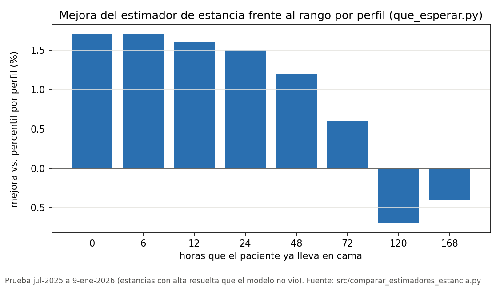

# A6b · Estimación de la estancia restante de un paciente hospitalizado (19-nov-2026)

**Qué pide el instructivo (componente 3):** «modelos analíticos o predictivos que permitan estimar tiempos de atención». La pregunta concreta, ahora para quien **ya tiene cama**: **¿cuánto le falta a este paciente para el alta?**

## Resumen
1. **Ya se había intentado y se había descartado.** Una prueba rápida (21-oct) con regresión directa de la estancia total al momento del ingreso dio **R² ≈ 0,00-0,02**, igual que adivinar la mediana (47 h). Un modelo explicativo posterior con más variables, incluido el diagnóstico (`src/factores_estancia.py`, 3-nov) llegó a **R² = 7,9 % (modelo A) / 10,8 % (modelo B)**, declarado ahí mismo como «explica, no predice»: el 90 % de la variación de la estancia no se explica con lo que se sabe al ingresar.
2. **Lo que nunca se probó es la arquitectura que sí funciona para la espera de cama.** Los dos intentos anteriores entrenaban un solo modelo AL INGRESAR para la estancia TOTAL. Este estimador (`src/estimador_estancia_restante.py`, `src/comparar_estimadores_estancia.py`) usa, en cambio, un modelo de supervivencia en tiempo discreto por cada hora **ya transcurrida en cama** («landmark»), igual idea que el estimador de la espera (`docs/estimador_tiempos.md`): reestima el riesgo de alta con lo que se sabe en ese momento, no solo al ingresar.
3. **La mejora es real pero modesta, y se publica con ese límite explícito.** Medida contra el baseline que ya usa el dashboard (`que_esperar.py`, percentil por perfil edad × sexo × tipo de visita), con 3.900 estancias de jul-2025 a 9-ene-2026 que el modelo no vio: mejora **1,6 % al momento de la asignación de cama (IC 95 % 0,9 a 2,4 %)**, bajando a medida que pasan las horas, y se vuelve modestamente negativa a partir de las 120 h (muestra de prueba ya chica: 1.219 y 814 estancias a las 120 y 168 h). Es muchísimo menor que el ~9-11 % del estimador de espera: lo que no se registra (servicio, tipo de cama, gravedad clínica) sigue explicando la mayor parte de cuánto dura una estancia.
4. **La censura se trata distinto a los dos intentos anteriores.** `que_esperar.py` y `factores_estancia.py` descartan las estancias sin alta resuelta antes del corte (sesgo: las estancias largas son justo las que más probablemente siguen abiertas cerca del corte). Aquí esas filas **siguen aportando al entrenamiento como censuradas**: en riesgo en cada landmark que alcanzaron, sin marcar nunca un alta que no se sabe si ocurrió.
5. **El diagnóstico de esta estancia entra como variable opcional (20-nov-2026).** Casi todos los diagnósticos se registran tarde (`comparar_estimadores.py::historial()`: el 88 % se registra después del inicio del episodio), así que en los datos históricos el diagnóstico final se trata como conocido desde la asignación de cama: eso puede **sobreestimar** su efecto. Se incluye porque la página «Paciente en cama» deja elegirlo y en el uso real el médico lo conoce, y porque mejora la estimación. Medido con la misma prueba (3.900 estancias de jul-2025 a 9-ene-2026 que el modelo no vio), la mejora frente al rango por perfil pasa de **2,4 % sin diagnóstico a 4,4 % con él** al asignarse la cama (de 1,3 a 3,2 % a las 72 h). El 31 % de las estancias no tiene diagnóstico: ahí la variable queda faltante y el modelo funciona igual. Sin indicar diagnóstico, la estimación es la de antes. Además sigue usando el diagnóstico de una hospitalización **anterior** (si la hubo).
6. **En el dashboard:** tiene su página (`dashboard/pages/paciente_cama.py`, ruta `/paciente-cama`, «Paciente en cama»), con el mismo patrón de formulario, tarjetas y gráfico (adaptado a bloques por día, no por franja) que «Paciente en espera».

---

## 1. Por qué se vuelve a intentar
La estancia hospitalaria (de la asignación de cama al alta) tiene mediana 69,5 h, p90 265,2 h y media 119,6 h (23.210 estancias únicas, feb-2023 a 9-abr-2026) — mucho más larga y más dispersa que la espera de cama (mediana 18,6 h). Los dos intentos anteriores de predecirla fallaron porque intentaban resolver, de una sola vez al ingresar, una pregunta demasiado difícil: «¿cuánto durará TODA la estancia?», con variables que apenas cambian entre pacientes parecidos.

La pregunta que sí se puede responder mejor es otra: **dado que el paciente YA lleva un número de horas en cama, ¿cuál es la probabilidad de que le den el alta en la próxima hora?** Esta es exactamente la pregunta que resuelve bien el estimador de la espera de cama (`docs/estimador_tiempos.md`), y nunca se había aplicado la misma idea a la estancia.

## 2. El estimador
Código: `src/estimador_estancia_restante.py` (consulta) y `src/comparar_estimadores_estancia.py` (construcción y prueba). Reutiliza, sin duplicar, el cruce de laboratorios y de historial de `src/comparar_estimadores.py`.

**Cómo funciona.** Para cada hora ya pasada en cama, el modelo estima la probabilidad de recibir el alta en la hora siguiente. Multiplicando esas probabilidades hora por hora sale la probabilidad de seguir en cama, y de ahí los percentiles de lo que falta. Usa árboles de gradiente (`HistGradientBoostingClassifier`).

| Grupo | Variables | Cuándo se conoce |
|---|---|---|
| Paciente | Edad, sexo, tipo de visita, horas que lleva en cama | Al asignarse la cama y en cada momento |
| Hospital | Hora del reloj, día de la semana, camas ocupadas en su zona | En cada momento |
| Diagnóstico | Grupo de diagnóstico de esta estancia, opcional (ver resumen, punto 5) | Lo indica quien consulta |
| Historial | De su última hospitalización: espera, estancia y hace cuántos días terminó; hospitalizaciones previas; grupo del último diagnóstico de una visita **anterior** | Al asignarse la cama |
| Laboratorios | Banderas de las primeras 6 h de la visita (fase 1: estáticas, ya conocidas para cuando se asigna la cama) | Al asignarse la cama |

**Qué NO usa, y por qué.** El recorrido en urgencias de esta visita (pertenece al tramo antes de la cama, no a la estancia en ella).

**Landmarks: [0, 6, 12, 24, 48] horas desde la asignación de cama; un modelo agrupado (dinámico) desde las 72 h.** Espaciado más esparcido que el estimador de espera (0 a 11 h, cada hora), porque la estancia opera a escala de días, no de horas. El corte en 72 h **se eligió midiendo, no a priori**: se probó un landmark propio también en 72, 120 y 168 h y midió peor en los tres puntos que el modelo agrupado que ya se usa desde esa hora (tabla siguiente) — la muestra de prueba en esas horas ya es chica (1.954, 1.219 y 814 estancias), y el modelo agrupado generaliza mejor donde hay menos estancias largas para entrenar un landmark propio.

| Landmark propio vs. modelo agrupado, evaluados en las mismas horas (mejora % vs. percentil por perfil) | 72 h | 120 h | 168 h |
|---|---|---|---|
| Landmark propio en esa hora | 0,5 % | −1,4 % | −1,7 % |
| Modelo agrupado (el que se usa) | **0,6 %** | **−0,7 %** | **−0,4 %** |

**Censura.** Una estancia sin alta resuelta antes del periodo confiable (aún hospitalizada, o que termina después) no se descarta: aporta al entrenamiento como censurada (en riesgo en cada landmark que alcanzó, sin marcar nunca un alta que no se sabe si ocurrió). Es una mejora metodológica real frente a `que_esperar.py` y `factores_estancia.py`, que descartan esas filas (sesgo contra las estancias largas, que son justo las que más probablemente quedan censuradas).

**Historial de hospitalización previa.** A diferencia del rediseño del 14-nov de la página de espera (que escondió este bloque por su correlación débil-moderada, 0,34, con la espera actual), aquí se mantiene visible: es la única fuente de diagnóstico sin riesgo de fuga, aunque su correlación con la estancia actual es más débil todavía (Spearman 0,24, n=2.816 pacientes con hospitalización previa resuelta).

**Cómo se consulta.**
```python
from estimador_estancia_restante import estimar_estancia_restante
estimar_estancia_restante(edad=67, sexo="Mujer", tipo_visita="Urgencias", horas_en_cama=30, ahora="2026-03-04 19:00",
                          hospitalizacion_previa={"espera_h": 40, "estancia_h": 120, "dias_desde": 60, "n_previas": 1})
```

## 3. La prueba
Entrenamiento con asignaciones de cama (`ini_hosp_est`) de feb-2023 a jun-2025; prueba con jul-2025 a 9-ene-2026 (90 días de margen antes del fin del periodo confiable, 9-abr-2026, para que las estancias largas alcancen a resolverse — mismo criterio que `src/estimador_tiempos.py` usa para su propia validación de estancia). La prueba solo puede usar estancias con alta resuelta (no se puede medir pérdida de cuantiles contra un desenlace que no se conoce); el entrenamiento sí usa las censuradas.

Métrica: pérdida de cuantiles contra el baseline ya en producción (`que_esperar.py`, percentil por perfil), no R² (R² solo se cita para los intentos anteriores, ya descartados).

| Horas ya en cama | n prueba | Mejora vs. percentil por perfil |
|---|---|---|
| 0 (al asignarse la cama) | 3.900 | **1,6 %** (IC 95 % 0,9 a 2,4 %) |
| 6 | 3.861 | 1,7 % |
| 12 | 3.765 | 1,6 % |
| 24 | 3.292 | 1,5 % |
| 48 | 2.554 | 1,2 % |
| 72 | 1.954 | 0,6 % |
| 120 | 1.219 | −0,7 % |
| 168 | 814 | −0,4 % |



## 4. Límites
- La mejora es muchísimo menor que la del estimador de espera (~9-11 %): lo que no se registra (servicio, tipo de cama, gravedad clínica — UCI, procedimientos) sigue siendo la mayor parte de lo que decide cuánto dura una estancia.
- A horas ya avanzadas (120-168 h) la ventaja frente al rango por perfil es modestamente negativa y la muestra de prueba es chica: en esos casos el rango que se muestra es, sobre todo, una descripción de pacientes parecidos.
- No usa la gravedad clínica. El diagnóstico de esta estancia entra si se indica, pero con el sesgo de registro tardío explicado arriba.
- Los laboratorios que usa son los de las primeras 6 horas de la visita (ya conocidos para cuando se asigna la cama), no laboratorios que varíen durante la propia estancia: eso requeriría una extracción nueva a partir de `measurement_datetime` (válido en el proyecto, a diferencia de `procedure_occurrence`, que no tiene fecha utilizable en ningún lado), pendiente como mejora futura.
- Mismo aviso de desactualización que el resto de los estimadores si la fecha consultada está lejos del fin del entrenamiento.

## 5. En el dashboard
Página `dashboard/pages/paciente_cama.py` (ruta `/paciente-cama`, «Paciente en cama», módulo que se abre desde el botón «Simular», entre «Paciente en espera» y el final de la lista de módulos): mismo patrón de formulario (edad, sexo, tipo de visita, horas ya en cama, historial opcional, laboratorios opcionales), tarjetas de resultado y gráfico con vista Normal/Acumulada que «Paciente en espera», adaptado a bloques por día (1 a 10 días + «más de 10 días») en vez de por franja del día, porque la estancia opera a escala de días.
